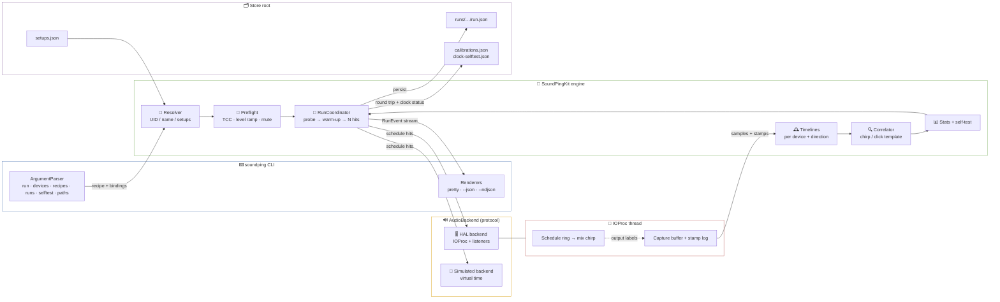
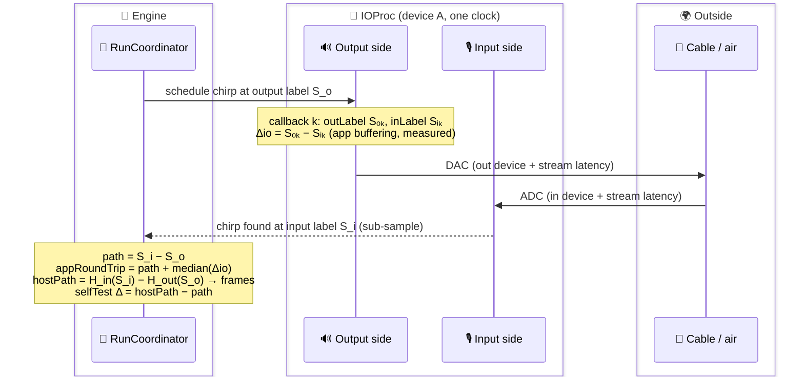
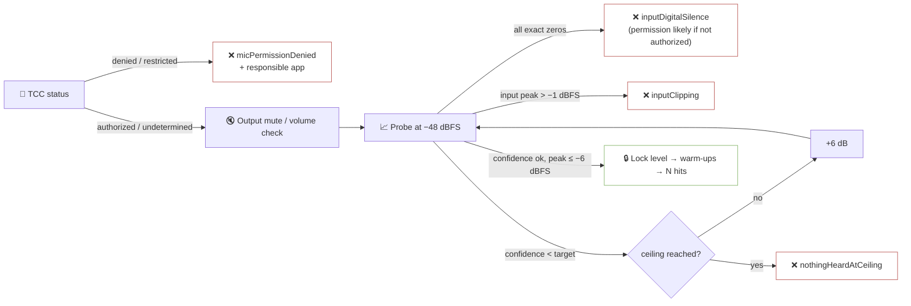

# Phase 1: Audio Round Trip - Research

**Researched:** 2026-11-11
**Domain:** Swift/SwiftPM engine + CLI over raw CoreAudio HAL: real-time capture/playback, chirp matched filter, host-clock mapping, stats, run store, licence gate
**Confidence:** MEDIUM-HIGH. Local toolchain, SDK headers, device properties, DSP accuracy and per-process buffer size were verified on this Mac. The HAL timestamp edge (does the label gap include safety offsets?) stays a bench question, and the plan is built so the bench answers it.

<user_constraints>
## User Constraints (from CONTEXT.md)

### Locked Decisions

### 🤖 Who the CLI is for
- **D-01:** The CLI is a temporary/secondary interface. Its main consumers are an **AI agent that Flo tells to run tests**, and Flo himself until the native app (Phase 6) exists. Optimise for machine-readable, deterministic use first; human-pretty output second.

### 🖥️ CLI flow & output
- **D-02:** Command shape is **recipe-generic**: `soundping run <recipe>` plus utility verbs:
  - `devices` (with `--json`)
  - `recipes` (with `--json`)
  - `runs list/show`
  - `selftest`
  - Phases 2–5 add recipe ids, not commands. Shared run flags live in one `@OptionGroup`. No `calibrate` alias.
- **D-03:** Output modes:
  - **Default:** pretty TTY.
    - One line per hit as it lands; rejected hits dimmed, with their reason
    - Summary block, Unicode-bar histogram, sparkline timeline
    - Honours `NO_COLOR`
  - **`--json`:** one final object. Contents:
    - summary stats
    - segments covered
    - corrections with their source
    - reported vs measured
    - `runId`
    - **absolute run path**
  - **`--ndjson`:** the live `RunEvent` stream.
  - **Streams:** data → stdout, progress/logs → stderr. Never print progress to stdout in JSON modes.
  - **Failures:** preflight and abort failures come out as structured JSON errors (e.g. `{"type":"error","code":"micPermissionDenied","terminalApp":"Ghostty"}`), with **distinct exit codes per class**: usage, preflight, device-change abort, gate fail.
  - One Codable schema (`RunEvent`/`RunResult`, with `schemaVersion`) feeds all three renderers. `--json` output = `run.json` = what the app reads later.
- **D-04:** Default **N = 100 hits, 5 warm-ups**, declared in the recipe's defaults. `--hits` / `--warmup` override. Fixed N, no adaptive stop. The numbers are to be sanity-checked on Flo's hardware.
- **D-05:** Host-clock self-test (CAL-03) runs **both ways**, from one shared engine function:
  - **Automatic:** computed inside every same-device round-trip run (Δ samples reported in the result); each such run refreshes the stored status.
  - **Explicit gate:** `soundping selftest clock` exits nonzero on fail.
  - The pass/fail status is persisted, keyed like calibrations (device, rate, buffer), for Phase 2's "unverified clock" label.
  - `selftest midi` arrives in Phase 2.
- **D-06:** Store root is `~/Library/Application Support/SoundPing/` (the app and the CLI resolve the same path).
  - **Override:** `SOUNDPING_HOME` env var / `--store` flag, for CI and tests.
  - **`soundping paths`** (or equivalent) prints the root, so agents don't fight the space in the path.
  - **Layout:** per ARCHITECTURE.md (`runs/<timestamp>-<slug>/run.json` + calibrations).

### 🎛️ Device & channel picking — PROVISIONAL
- **D-07:** ⚠️ **Provisional: Flo expects to tweak this after hands-on use.** Keep the setups schema small and versioned, and build nothing else on top of it yet.
- **D-08:** **One resolver** for audio + MIDI, shared later with the app picker:
  - **Selector:** an exact UID, else a unique case-insensitive name match. Exact name beats substring.
  - **Errors:** ambiguous or missing selectors fail with the candidate list (UIDs included).
  - **`devices` row numbers** are display-only and never accepted as selectors.
  - MIDI endpoints are listed with `kMIDIPropertyUniqueID` now, though MIDI recipes start in Phase 2.
- **D-09:** **Named setups** live in a config file:
  - **Fields:** output, input, in-channel, out-channels, midi-out.
  - **Usage:** `--setup <name>`; flags override individual fields.
  - **Identity:** each binding stores UID + display name.
  - **UID miss** (e.g. a USB device moved to another port changes its UID): fall back to the exact stored name, with a loud warning that the calibration may not apply.
  - **Calibration key:** stays UID-based.
- **D-10:** **No implicit system defaults, ever.** `default` is accepted only as an explicit keyword, resolved and pinned to a UID at arm time, then printed.
- **D-11:** **Channels are explicit state** (1-based, shown with the HAL channel names), part of the calibration key.
  - **`--in-channel auto`:** a one-shot helper. It probes, prints the channel it found with its confidence (margin rule; an error if two channels tie), and offers to save it into the setup. Never a silent per-run guess.
  - **Output:** defaults to the device's preferred stereo pair; `--out-channels` overrides.

### 🔊 Test sound & level (Claude's discretion, research-backed; Flo deferred to the research)
- **D-12:** **Stimulus:** a short band-limited log **chirp** (~20–50 ms, Tukey-faded), detected by matched filter:
  - normalised correlation peak (0–1) as confidence
  - peak-to-sidelobe and "first peak above k·max" checks, against reflections
  - parabolic sub-sample interpolation
  - **Band per listener:** ~300 Hz–8 kHz for speaker/mic, wider for loopback. Tune on the bench.
- **D-13:** **One correlator, generic over the template** (the template is data).
  - A windowed short click ships as an **A/B control template**.
  - Run the chirp-vs-click comparison on the bench early, since the Apple Silicon built-in mic DSP behaviour is unverified.
  - Only OboeTester's confidence formula may be borrowed (Apache-2.0, keep its header + NOTICE); not its coded-burst stimulus.
- **D-14:** **Level policy: auto-ramp, then lock.**
  - **Ramp:** probe hits start at ≈ −48 dBFS and step +6 dB until confidence/SNR clears the target with input peak ≤ −6 dBFS.
  - **Ceilings:** a hard ceiling per listener, lower when the output data source reports headphones.
  - **Lock:** the level is locked for the whole run; warm-ups double as probes.
  - **At the ceiling:** "nothing heard at ceiling" becomes a named preflight cause (check cable / permission / volume / interface gain).
  - This implements ENG-03's silent/clipping preflight.
- **D-15:** The chirp is designed for **reuse in Phase 2**, as the bundled DAW sample and reference click (an up/down chirp pair stays separable). Don't make choices that block this.

### 📜 Licence: PolyForm Shield 1.0.0 (source-available, not OSI open source)
- **D-16:** SoundPing is licensed under **PolyForm Shield 1.0.0** — **Reversibility:** costly — the licence can be relaxed later (to MPL, GPL or others) only while Flo holds relicensing rights to every contribution, hence the CLA; versions already released stay under Shield.
  - **Intent:** free for anyone to use, professionals included; nobody may offer a competing product, paid or free.
    - Shield bans *competing products*, not profit in general. A consultant charging to measure latency with SoundPing is fine.
  - **Rejected:**
    - GPL-3.0, because it allows selling.
    - MIT, Apache-2.0 and MPL-2.0, because they allow closed commercial products.
    - PolyForm Noncommercial, because it would ban paid musicians.
    - FSL, because its automatic 2-year opening isn't wanted.
- **D-17:** **Exit-gate licence work** (lands before any ported code):
  - **`LICENSE`:** the full verbatim PolyForm Shield 1.0.0 text, from `PolyForm-Shield-1.0.0.md` in GitHub `polyformproject/polyform-licenses` (the polyformproject.org URL may 404).
    - Add `Required Notice: Copyright 2026 Flo Kempenich`.
    - **No** `Licensor Line of Business:` line (deliberately left out; verify against the actual text whether the field exists).
  - **`CLA.md`:**
    - **Grant:** contributors give Flo a perpetual, irrevocable licence to their contributions, including the right to sublicense and relicense under any terms, commercial ones included.
    - **Copyright:** contributors keep it.
    - **Not a DCO:** a DCO isn't enough.
    - **Basis:** an established template (Apache ICLA-style or Contributor Agreements / Harmony), not written from scratch.
  - **`CONTRIBUTING.md`:** contributions require signing the CLA; a bot asks on the first PR.
  - **README licence section,** exact text approved by Flo:
    > **Licence**
    >
    > Free for anyone to use, including professionally. You may modify and share it, but not offer a competing product. Source-available under [PolyForm Shield 1.0.0](LICENSE).
    >
    > The licence is deliberately strict for now and may be relaxed to a more open one later.
  - **Doc wording:** change "open source" → "source-available (PolyForm Shield 1.0.0)" wherever it describes the licence, and record the decision + rationale in PROJECT.md Key Decisions. Files:
    - `.planning/PROJECT.md`: the constraint and the Key Decisions table
    - `.planning/REQUIREMENTS.md`: REL-04's "open-source licence", and the telemetry row's "Open-source tool"
    - `.planning/ROADMAP.md`: the Phase 1 exit gate wording, and the Phase 7 title "Open-Source Release"
    - `.planning/research/STACK.md`: the licence-check table header "OK for any SoundPing licence?" covers Shield; all shipped deps are MIT/Apache-2.0 and pass, GPL tools stay dev-only
    - `CLAUDE.md` / `AGENTS.md`: the same (CLAUDE.md is partly generated from STACK.md, so fix the source too)
  - **Oboe LatencyAnalyzer port** (if it happens): keep its Apache-2.0 header + NOTICE attribution on the ported files; this is compatible with Shield for the rest of the repo.
- **D-18:** **CLA bot is Flo's manual step,** not an agent task: install CLA Assistant on the GitHub repo **before the repo goes public**. It doesn't block the Phase 1 exit gate.

### Claude's Discretion
- Stimulus design, detector checks and level-ramp parameters (D-12..D-15). Flo deferred to the research; tune on the bench.
- Exact pretty-output layout, exit-code numbering, the JSON field names (as long as they stay Codable and versioned), and the config file format/location for setups (TOML or JSON under `~/.config/soundping/` or the store root).

### Deferred Ideas (OUT OF SCOPE)
- Adaptive stopping (run until the median CI is tight): revisit if the key-press / BT MIDI recipes prove highly variable (Phase 4–5).
- Multi-sine "precision loopback" mode: only if 1–2 sample accuracy ever proves too coarse.
- `calibrate` alias: not now; reconsider for strangers' docs in Phase 7.
</user_constraints>

<phase_requirements>
## Phase Requirements

| ID | Description | Research Support |
|----|-------------|------------------|
| ENG-01 | List audio + MIDI devices, select by stable ID | 🎚️ HAL enumeration + channel names verified on this Mac; MIDI `kMIDIPropertyUniqueID` is a **signed** Int32 (negative values seen) → pitfall P7 |
| ENG-02 | Run any recipe from the CLI, each hit live | 🧪 `AsyncThrowingStream<RunEvent>` + custom-Codable events → pretty / `--json` / `--ndjson` renderers |
| ENG-03 | Preflight names the cause (permission + terminal app, silent, clipping) | 🔐 TCC status readable from a CLI (verified); responsible-app detection by process-tree walk (verified → "Ghostty"); level ramp (D-14) gives silent/clipping/"nothing heard at ceiling" |
| ENG-04 | Randomised spacing, warm-ups discarded | 📅 Schedule ring consumed by the IOProc; seeded RNG; uniform spacing in a range |
| ENG-05 | `--simulate` with injected latency + jitter, in CI | 🧪 `AudioBackend` protocol + virtual-time simulated backend (no CoreAudio calls); GitHub `macos-26` runner has Xcode 26.6 (verified) |
| ENG-06 | Result states segments covered + corrections with source | 🧾 Recipe declares segments; Phase 1 corrections list is explicit `none`; HAL numbers shown as `reported`, never applied |
| ENG-07 | Abort on device gone / rate or buffer change | 👂 Property listeners (`'livn'`, `'nsrt'`, `'fsiz'`, `'slay'`, `'dev#'`, `'over'`, `'stpd'`) + sample-time discontinuity check in the IOProc |
| RES-01 | Valid/N, median, p5–p95 jitter, p95, max, histogram, timeline; outliers kept | 📊 Percentiles by linear interpolation (numpy default) so offline cross-checks match exactly |
| RES-02 | Reported vs measured | 📐 Two measured figures (`path`, `appRoundTrip`) vs two reported sums, each with its term breakdown |
| CAL-01 | Round trip in samples + ms, repeatable within 1–2 samples on loopback | 🔍 Chirp matched filter prototype: max error 0.007–0.044 samples (verified locally) |
| CAL-02 | Stored per device pair, rate, buffer; labelled round trip, never mic delay | 📐 `CalibrationKind` enum has **no** mic-delay case; key includes channels (D-11) + SoundPing's **own** per-process buffer |
| CAL-03 | Host-clock self-test within ~2 samples | 🕰️ Same-device run computes sample path and host path through the **generic per-direction timelines**; cross-check with `AudioDeviceTranslateTime` |
| RUN-01 | Every run saved with metadata + label + tags | 🗂️ `runs/<UTC timestamp>-<slug>/run.json`, atomic writes, slug sanitised |
</phase_requirements>

## 🧭 Summary

- 🏗️ **Greenfield Swift package**, two targets plus tests: `SoundPingKit` (engine library) and `soundping` (CLI). The CLI never touches CoreAudio. Everything runs through one `RunCoordinator` emitting `RunEvent`s, with a **simulated backend on virtual time**, so the whole recipe runs in CI in well under a second.
- 🔬 **New findings from this session**, beyond the project research:
  - **The IO buffer size is per process** (verified by experiment). SoundPing can set its own buffer (e.g. 128 to match Ableton) without touching other apps. The calibration key must record SoundPing's buffer.
  - **The built-in mic reports its ~30 ms DSP delay as *stream* latency** (1439 frames, verified). Tools that read only `kAudioDevicePropertyLatency` miss it. Always sum device + stream latency.
  - **The IOProc's two timestamps give two measurable quantities.** One is the label gap of the hardware path. The other is the per-callback output-minus-input offset, i.e. the app-level buffering. Measuring both settles the disputed safety-offset arithmetic on the bench.
  - **`@_noLocks` works on this toolchain** (Swift 6.4.2, verified). It catches refcounting and allocation on the real-time path at compile time.
  - **The repo is already public on GitHub, with no LICENSE.** D-18 ("before the repo goes public") is already past due, so the licence plan should go first.
- 🎯 **Measurement design is settled by tests, not by trust.** Chirp detection is sub-sample on synthetic data. The bench run on Flo's Scarlett (cable loop and "Loop 1/2" channels) plus the MacBook speakers → mic is the exit gate.

**Primary recommendation:** Land the licence + scaffold first, then a walking skeleton that runs `soundping run round-trip --simulate --json` end to end in CI. Then grow the DSP and the HAL backend in parallel, and close with a human-verified bench checkpoint (repeatability + clock self-test).

## 🗺️ Architectural Responsibility Map

| Capability | Primary Tier | Secondary Tier | Rationale |
|------------|-------------|----------------|-----------|
| Arg parsing, rendering (pretty/json/ndjson), exit codes | ⌨️ CLI (`soundping`) | — | Pure consumer of `RunEvent`/`RunResult` (D-03) |
| Recipe registry, run lifecycle, warm-up/probe/level lock | 🧪 Engine (`RunCoordinator` actor) | — | Shared with the Phase 6 app |
| Play chirps at exact sample positions, capture input, stamp log | 🔴 Real-time IOProc (HAL thread) | Engine (schedule ring writer) | Only the IOProc knows the output sample labels; no locks/allocs there |
| Sample ↔ host mapping, self-test math | 🕰️ Engine (`Clock`) | HAL (`AudioDeviceTranslateTime` cross-check) | Pure, unit-testable on both timebases |
| Detection, confidence, stats, histogram | 🔍 Engine (pure DSP) | — | Pure functions over buffers; bulk of the tests |
| Device/channel/MIDI enumeration, property listeners | 🎚️ Hardware adapter | — | The only CoreAudio/CoreMIDI callers |
| TCC status + responsible-app naming | 🔐 Engine preflight (protocol) | OS (TCC) | Simulated in CI; real impl reads AVFoundation + process tree |
| Runs, calibrations, self-test status, setups | 🗂️ Local store (Application Support) | — | Contract with Phase 2 (clock status) and Phase 6 (app reads runs) |
| Gear-free runs | 🧪 Simulation backend (in `SoundPingKit`) | CI | `--simulate` for demos and bug reports, not just tests |

## 🧰 Standard Stack

### Core

| Library | Version | Purpose | Why Standard |
|---------|---------|---------|--------------|
| Swift / SwiftPM | toolchain 6.4.2 local, 6.3.x on CI; `swift-tools-version: 6.2` | Engine, CLI, tests | Swift 6 language mode by default; IOProc block compiles under strict concurrency with no diagnostics [VERIFIED: local build, `swift build -swift-version 6`] |
| CoreAudio HAL | macOS SDK 27.2 | IOProc per device, properties, listeners | Raw `AudioTimeStamp` per buffer [VERIFIED: SDK `AudioHardware.h:796-836`] |
| CoreMIDI | system | Enumerate sources/destinations with unique IDs (ENG-01 only) | [VERIFIED: local spike listed 4 sources + 4 destinations] |
| Accelerate / vDSP | system | `vDSP_conv` correlation, `vDSP_maxvi`, `vDSP_dotpr`, `vDSP_svesq` | Positive filter stride = correlation [VERIFIED: local prototype, peak at injected delay] |
| `Synchronization.Atomic` | stdlib (macOS 15+) | IOProc ↔ analysis indices | [VERIFIED: compiles inside the IOProc block + `@_noLocks`] |
| swift-argument-parser | **1.8.2** (2026-06-04) | Subcommands, `@OptionGroup`, `AsyncParsableCommand` | [VERIFIED: GitHub releases API; Context7 `/apple/swift-argument-parser`] |
| swift-log | **1.17.0** (2026-11-04) | stderr diagnostics | [VERIFIED: GitHub releases API]; its `Package.swift` declares `swift-tools-version:6.2` |
| Swift Testing | toolchain | Unit + simulation tests | Bundled; no install |

### Supporting

| Library | Version | Purpose | When to Use |
|---------|---------|---------|-------------|
| AVFoundation | system | `AVAudioApplication.shared.recordPermission`, `AVCaptureDevice.authorizationStatus(for: .audio)` | Preflight only; never in the capture graph. Both readable from a CLI process [VERIFIED: returned `'gran'` / `3` under Ghostty] |
| `libproc` / `sysctl` (Darwin) | system | Name the responsible terminal app | Preflight message (P4) [VERIFIED: prototype printed `Ghostty`, `com.mitchellh.ghostty`] |
| just | 1.59.0 | `just test`, `just cli`, `just sim`, `just selftest` | Flo's convention [VERIFIED: local `just --version`] |
| `swift format` | 6.4.4 (bundled) | Format/lint | [VERIFIED: local] |

### Alternatives Considered

| Instead of | Could Use | Tradeoff |
|------------|-----------|----------|
| Swift IOProc + `@_noLocks` | Small C target for the IOProc | C removes all Swift-runtime doubt but adds a target and C11 atomics. Keep it as the fallback if `@_noLocks` is ever dropped or an RT bug appears |
| Direct `vDSP_conv` correlation | FFT correlation (`vDSP.FFT`) | Direct is O(N·P) ≈ 35M MACs per 0.5 s window with a 30 ms template: milliseconds on M4. FFT only if windows grow |
| JSON for setups | TOML | TOML needs a third-party parser; JSON is Codable with zero deps |
| `ZNCC − noise/signal` (own code) | Port Oboe `calculateNormalizedCorrelation` | Oboe's formula `2Σab / Σ(a²+b²)` is **gain-sensitive** (needs the recording normalised first). Write a gain-invariant ZNCC instead, and credit Oboe for the noise-ratio idea |
| RTSanStandaloneSwift (runtime RT sanitizer) | — | Third-party, low adoption [ASSUMED]. `@_noLocks` gives a compile-time check already |

**Installation:**
```swift
// Package.swift
// swift-tools-version: 6.2
import PackageDescription
let package = Package(
  name: "SoundPing",
  platforms: [.macOS(.v15)],
  products: [
    .library(name: "SoundPingKit", targets: ["SoundPingKit"]),
    .executable(name: "soundping", targets: ["soundping"]),
  ],
  dependencies: [
    .package(url: "https://github.com/apple/swift-argument-parser", exact: "1.8.2"),
    .package(url: "https://github.com/apple/swift-log", exact: "1.17.0"),
  ],
  targets: [
    .target(name: "SoundPingKit", dependencies: [.product(name: "Logging", package: "swift-log")]),
    .executableTarget(name: "soundping", dependencies: [
      "SoundPingKit", .product(name: "ArgumentParser", package: "swift-argument-parser")]),
    .testTarget(name: "SoundPingKitTests", dependencies: ["SoundPingKit"]),
  ]
)
```

## 📦 Package Legitimacy Audit

- `gsd-tools package-legitimacy` supports npm/PyPI/crates only. SwiftPM has no registry here, so both packages were verified against their official `apple/` GitHub org (releases API) and Context7.

| Package | Registry | Age | Downloads | Source Repo | Verdict | Disposition |
|---------|----------|-----|-----------|-------------|---------|-------------|
| swift-argument-parser 1.8.2 | GitHub (SwiftPM) | 6+ yrs | n/a | github.com/apple/swift-argument-parser | OK (official Apple org + Context7) | Approved |
| swift-log 1.17.0 | GitHub (SwiftPM) | 7+ yrs | n/a | github.com/apple/swift-log | OK (official Apple org) | Approved |

**Packages removed due to [SLOP] verdict:** none
**Packages flagged as suspicious [SUS]:** none
- 📌 Pin with `exact:` and commit `Package.resolved` (supply chain, V14).

## 🏛️ Architecture Patterns

### System Architecture Diagram



### Recommended Project Structure

```
Package.swift · Package.resolved · justfile · LICENSE · CLA.md · CONTRIBUTING.md · README.md
scripts/                       # logic that just calls (ci-sim.sh, bench.sh)
.github/workflows/ci.yml       # macos-26: swift test + simulated run
Sources/
├── SoundPingKit/
│   ├── Audio/                 # HALBackend, DeviceCatalog, IOProc RT state, listeners
│   ├── MIDI/                  # endpoint listing only (Phase 1)
│   ├── Clock/                 # HostClock (timebase), DeviceTimeline (stamp log + fit)
│   ├── Simulation/            # SimulatedBackend, Scenario, seeded RNG
│   ├── Stimulus/              # chirp + click templates (data)
│   ├── Detection/             # Correlator, PeakPicker, rejection reasons
│   ├── Stats/                 # percentiles, histogram
│   ├── Preflight/             # PermissionProbe, ResponsibleApp, LevelRamp
│   ├── Recipes/               # Recipe, RoundTripRecipe, registry
│   ├── Engine/                # RunCoordinator, RunEvent, RunResult (Codable)
│   └── Store/                 # StorePaths, RunStore, CalibrationStore, Setups
└── soundping/
    ├── Commands/              # Run, Devices, Recipes, Runs, Selftest, Paths
    └── Render/                # Pretty, JSON, NDJSON, ErrorEnvelope, ExitCodes
Tests/SoundPingKitTests/       # Swift Testing: DSP, stats, clock, sim runs, store, codable
```

### 🧭 Suggested plan slicing (walking skeleton first)

| # | Plan | Wave | Delivers | Gate |
|---|------|------|----------|------|
| 1 | 📜 Licence + scaffold | 1 | LICENSE, CLA.md, CONTRIBUTING, README licence + stale intro, doc wording sweep, Package.swift, justfile, CI skeleton | Licence before any code beyond scaffold; `checkpoint:human-verify` on CLA.md text |
| 2 | 🦴 Walking skeleton | 2 | RunEvent/RunResult, Recipe `round-trip`, RunCoordinator, SimulatedBackend, minimal correlator + stats + store, `run round-trip --simulate --json` in CI | Injected latency recovered |
| 3 | 🔍 DSP + stats depth | 3 | Chirp/click templates, ZNCC confidence, PSR, first-peak, parabolic, rejections, histogram, pretty + ndjson renderers | Synthetic accuracy tests |
| 4 | 🎚️ HAL backend | 3 (parallel to 3) | `devices`, resolver + setups, RT IOProc, schedule ring, stamp logs, listeners/abort, per-process buffer | Hardware-tagged smoke tests |
| 5 | 🛂 Real round trip | 4 | Preflight (TCC + responsible app, ramp, mute), host path for two devices, reported vs measured, calibration store, self-test (auto + `selftest clock`), `runs list/show` | — |
| 6 | 🧪 Bench gate | 5 | Human-verified runs on Scarlett cable loop, Scarlett "Loop 1/2", MacBook speakers → mic; chirp-vs-click A/B | Exit gates (CAL-01 repeatability, CAL-03 self-test) |

### Pattern 1: 🔴 Real-time IOProc (no locks, no allocation, compile-checked)

**What:** The IOProc block is a thin trampoline into `@_noLocks` functions working only on preallocated pointers and `Atomic`s.
**When:** All code reachable from the IOProc.

- 📥 **Per callback, the IOProc does exactly this:**
  - Copy the selected input channel (de-interleave) into a preallocated mono capture buffer indexed by `inputSampleTime − firstInputSampleTime`.
  - Append `(inSampleTime, inHostTime, inRateScalar, outSampleTime, outHostTime, outRateScalar, frames)` to a preallocated stamp log.
  - Mix any scheduled hit overlapping `[outSampleTime, outSampleTime + frames)` from the template buffer × gain into the selected output channels.
  - Detect a discontinuity (`inSampleTime ≠ previous + previousFrames`) → set an atomic flag + log the gap.
  - `store(..., ordering: .releasing)` the write indices.
- 📤 **Schedule ring (SPSC):** the engine writes `{outputSampleTime, gain, templateID, hitIndex}` entries ≥ 100 ms ahead of the latest output stamp. The IOProc only reads. Both the adaptive probe phase (D-14) and fixed hits use the same ring.
- 🧵 **Analysis side:** a task polls the atomic indices every ~5–10 ms (`Task.sleep`). It runs detection once a hit's window `[S_o, S_o + maxLatency]` is fully captured.
- 🪫 **Swift caveat:** `@_noLocks` is underscored (unofficial). If a future toolchain drops it, removing the attribute changes nothing at runtime. Keep the C-target fallback in mind.

### Pattern 2: 🕰️ What exactly gets measured



- 📏 **`path` (sample domain, same device only):** `S_i − S_o` in input-device frames. Expected to contain converter + driver latencies (and cable/air), not the app's buffers. [ASSUMED: the bench confirms it]
- 🔁 **`appRoundTrip`:** `path + median(Δio)`. What a monitoring app at this buffer would experience. This matches what RTL Utility and DAW "overall latency" figures express. **Headline number + calibration value.**
- 🕰️ **Host path:** map `S_o` through the output timeline and `S_i` through the input timeline to host ns, then to frames (nominal rate). Two-device runs (MacBook speakers → mic) use **only** this path.
- 🧪 **Self-test (CAL-03, D-05):** in a same-device run, compute the host path through the **same generic per-direction timeline code that two-device runs use**. Never take a shortcut via the duplex callback. Pass when `|median Δ| ≤ 1` and `p95 |Δ| ≤ 2` frames [ASSUMED thresholds; requirement says "~2 samples"].
  - Add the HAL's own `AudioDeviceTranslateTime` (sample → host, device running) as a diagnostic third opinion [VERIFIED: SDK `AudioHardware.h:1490-1508`].
  - ⚠️ **Limit:** a bias shared by both directions' stamps cancels out and goes undetected. The self-test proves the in/out timelines are consistent, not their absolute alignment to MIDI host time. Phase 2's `selftest midi` / reference click covers that.
- 🧮 **Timeline fit:** local least squares over ±16 callbacks around the target sample, `rateScalar`-aware, flags `kAudioTimeStampSampleHostTimeValid` checked. Never one global fit (drift).

### Pattern 3: 📐 Reported latency, both sums

- Per direction `d ∈ {in, out}` (scope input/output):
  - `deviceLatency_d` (`'ltnc'`) + `streamLatency_d` (`kAudioStreamPropertyLatency` of the stream holding the chosen channel) + `safetyOffset_d` (`'saft'`) + `bufferFrames` (SoundPing's own `'fsiz'`).
- **Reported path** = Σ device + stream latency (in + out) ↔ measured `path`.
- **Reported app round trip** = reported path + safety in + safety out + buffer in + buffer out ↔ measured `appRoundTrip`.
- **Also show `median(Δio)` vs `buffer×2 + safeties`.** That gap is the disputed safety-offset arithmetic, settled per device by data.
- 🔢 **Sanity numbers from Flo's devices** (48 kHz, read this session) [VERIFIED: local HAL spike]:
  - Scarlett 16i16 4th Gen: in dev 25 / stream 0 / safety 14; out dev 32 / stream 0 / safety 14 → reported path 57 frames (1.19 ms); at buffer 128 the reported app round trip is 341 frames (7.10 ms).
  - MacBook Pro Microphone: dev 14 / **stream 1439** / safety 36. MacBook Pro Speakers: dev 60 / **stream 690** / safety 48 → reported path 2203 frames (45.9 ms) before air time.

### Pattern 4: 🔍 Stimulus + correlator (D-12..D-15)

- 🎵 **Chirp:** exponential sweep, 30 ms, Tukey α = 0.1.
  - Speaker/mic band 300 Hz–8 kHz; loopback band 100 Hz–20 kHz (cap at 0.45·fs).
  - Store the template as data (`[Float]` + metadata: id, band, duration, direction up/down). Phase 2 then gets an up/down pair (D-15).
- 🎯 **Detection, per hit window:**
  - `vDSP_conv` (positive stride = correlation) → `|c|` → argmax.
  - **First-peak rule:** the earliest local max ≥ k·max (k ≈ 0.5) wins, against reflections.
  - **Parabolic** interpolation on `|c|` (handles polarity inversion).
  - **Confidence** = ZNCC at the integer peak (`Σab / √(Σa²·Σb²)`, gain-invariant) − noise/signal RMS ratio, clamped at 0 (Oboe's idea, own code).
  - **Peak-to-sidelobe ratio** outside ±1 ms of the peak.
- 📈 **Prototype accuracy on this Mac** (fractional delays 1000.00–1000.95, both polarities, ±5 % noise) [VERIFIED: local Swift + vDSP prototype]:
  - 300 Hz–8 kHz: max error **0.014 samples**, |ρ| ≥ 0.98.
  - 100 Hz–20 kHz: max error **0.044 samples**, |ρ| ≥ 0.94 (the parabola fits a sharper peak less well, still ≪ 1 sample).
- 🅰️🅱️ **Click control template:** a 1 ms Hann-windowed click through the same correlator (D-13). Run both on the bench.
- 🚫 **Rejection reasons** (counted, never silently dropped): `noPeak`, `lowConfidence`, `ambiguousPeaks`, `clipped`, `discontinuity` (xrun inside the window), `outsideWindow`.

### Pattern 5: 🛂 Preflight + level ramp (ENG-03, D-14)



- 🔐 **Permission:** `AVCaptureDevice.authorizationStatus(for: .audio)`.
  - `.notDetermined` → request access before arming. The prompt is attributed to the responsible app.
  - All-zero capture with `.authorized` → `inputDigitalSilence` (muted input, wrong channel, virtual device with no source), never "permission".
- 🔊 **Ceilings** [ASSUMED, tune on bench]:
  - Loopback (cable / `Loop` channels): −6 dBFS.
  - Speakers: −12 dBFS.
  - Built-in output with data source `'hdpn'`: −30 dBFS.
  - **Unknown interface outputs:** −18 dBFS, unless `--max-level` is given (interface headphone jacks look like line outs).
- 🔁 **Probes vs warm-ups:** −48 → −6 dBFS takes 7 steps, more than the 5 declared warm-ups. Probe hits are their own phase (`phase: "probe"`, not counted), then the 5 warm-ups run at the locked level. See Open Question 1.
- 🔇 **Mute:** check `'mute'`, `'volm'` and `'appm'` (process mute) on the output scope when the device implements them [VERIFIED: selectors in SDK `AudioHardware.h:1299-1313`, `'appm'` in the device enum].

### Pattern 6: 🧾 RunEvent / RunResult contract

- **Custom `Codable` with a `type` discriminator.** Swift's synthesized enum coding (`{"hit":{"_0":…}}`) is not agent-friendly and not stable.
- **Events:**
  - `armed` (setup snapshot, reported latencies, params, seed)
  - `probe` (level, confidence, peak)
  - `levelLocked`
  - `hit` (`phase: warmup|measure`, index, `latencyFrames`, `latencyMs`, confidence, psr)
  - `rejected` (index, reason)
  - `selfTest`
  - `aborted` (code, detail)
  - `finished` (RunResult)
- **RunResult:**
  - `schemaVersion`, `runId`, `runPath` (absolute), `createdAt` (ISO-8601 UTC), `toolVersion`, `os`, `hostTimebase`
  - `recipe {id, version}`, `label`, `tags`
  - `setup` (UIDs + names + transport + clockDomain + rate + SoundPing buffer + channels with HAL names)
  - `reported` (breakdown + both sums)
  - `measured {path, appRoundTrip, ioOffset}`, each as `{median, p5, p95, jitter, max, min, valid, n}` in frames + ms
  - `histogram`, `hits[]` (timeline incl. rejected), `rejectedCounts`
  - `segments[]`, `corrections[]` (Phase 1: none, `source: "none"`), `selfTest`, `calibration {key, kind: "roundTrip"}`
- 🔤 Encode with `.sortedKeys` + ISO-8601 dates so `--json`, `run.json` and the app read identical bytes.

### Pattern 7: 🧪 Simulated backend on virtual time

- `AudioBackend` protocol:
  - `open(bindings)`, `start()`, `schedule(_:)`
  - `waitUntilCaptured(throughInputSample:) async`
  - `capture(range)`, `stamps(range)`, `events: AsyncStream<DeviceEvent>`
- **The coordinator waits on sample positions, never wall-clock sleeps.**
  - The simulated backend synthesises buffers on demand, so a 100-hit run takes milliseconds in CI.
  - The real backend polls.
- **Scenario knobs:**
  - Timebase (125/3 default), rate scalar drift, latency distribution (fixed + Gaussian/uniform jitter, sub-sample), noise floor
  - Missed hits, clipping, all-zero input + permission state, mid-run faults (`deviceGone@hit`, `sampleRateChange@hit`, `bufferChange@hit`, `xrun@hit`)
- **Seeded RNG** (SplitMix64, ~10 lines; stdlib has none). The seed is stored in `run.json` → reproducible bug reports.
- **No CoreAudio calls on the `--simulate` path** (CI runners may have no audio devices).

### Pattern 8: 🎯 Resolver, setups, channels (provisional, D-07..D-11)

- Audio selector: exact UID → exact case-insensitive name → unique substring → error listing candidates with UIDs. `default` keyword → `kAudioHardwarePropertyDefault{Input,Output}Device` resolved and printed.
- MIDI selector: unique ID (Int32, may be negative) or name. Listing only in Phase 1.
- Channels 1-based, shown with `kAudioObjectPropertyElementName`. Example: Scarlett inputs `"Input 1"…"Input 6"`, `"Loop 1"`, `"Loop 2"`, `"S/PDIF 1"`… [VERIFIED: local spike]. Output default = `kAudioDevicePropertyPreferredChannelsForStereo` (Scarlett out → `[1, 2]`).
- Channel → (stream index, channel within stream) via `kAudioDevicePropertyStreamConfiguration`. Never assume one stream.
- `setups.json` at the store root (`schemaVersion: 1`), so `SOUNDPING_HOME` isolates tests completely.

### Pattern 9: 🗂️ Store

- **Root:** `SOUNDPING_HOME` → `--store` → `FileManager.url(for: .applicationSupportDirectory)/SoundPing`.
- **Files:**
  - `runs/<yyyyMMdd'T'HHmmss'Z'>-<slug>/run.json`. Slug = recipe + label, lowercased `[a-z0-9-]`, ≤ 48 chars.
  - `calibrations.json`, keyed by `{outputUID, outChannels, inputUID, inChannel, sampleRate, bufferFrames}`.
  - `clock-selftest.json`, same key shape.
  - `setups.json`.
- **Writes:** atomic (`Data.write(options: .atomic)`).
- **One run at a time:** `flock` on `<root>/.run.lock`. Two agent-launched runs must not fight over devices; the second exits `busy`.
- **`soundping paths --json`:** prints all absolute paths.

### Pattern 10: 👂 Mid-run abort (ENG-07)

- **Device listeners** (`AudioObjectAddPropertyListenerBlock` on a serial queue):
  - `'livn'` DeviceIsAlive
  - `'nsrt'` NominalSampleRate
  - `'fsiz'` BufferFrameSize
  - `'slay'` StreamConfiguration
  - `'over'` ProcessorOverload
  - `'stpd'` IOStoppedAbnormally
- **System listener:** `'dev#'` (Devices list).
- **Classification:**
  - Rate/buffer/config change or device gone → **abort** (`deviceChanged`, own exit code).
  - Overload or sample-time discontinuity → reject the hits whose window overlaps, and count them.
- [VERIFIED: four-char codes in SDK `AudioHardware.h:1015-1023`, `AudioHardwareBase.h:741-758`, `AudioHardware.h:608`]

### Anti-Patterns to Avoid

- **Changing the device sample rate:** it is device-global, so it changes the DAW's setup [CITED: project PITFALLS #11]. Read it and log it; never set it.
- **Not setting SoundPing's own buffer:** the default 512 makes the app round trip unlike the DAW's 128. Offer `--buffer N` (per-process, safe) and record it.
- **Reading only `kAudioDevicePropertyLatency`:** misses the built-in mic's 1439-frame stream latency.
- **Synthesised Codable on enums with payloads:** unstable JSON for agents.
- **Wall-clock sleeps in the coordinator:** makes `--simulate` slow and flaky.
- **`print` to stdout for progress:** breaks `--json`. Progress goes to stderr (D-03).

## 🚫 Don't Hand-Roll

| Problem | Don't Build | Use Instead | Why |
|---------|-------------|-------------|-----|
| Host ticks ↔ ns | Ad-hoc multiply | `AudioConvertHostTimeToNanos` / `mach_timebase_info` (125/3 here) | Apple Silicon ticks ≠ ns [VERIFIED: `HostTime.h:81-91`, local timebase 125/3] |
| Sample ↔ host for diagnostics | Trusting only own fit | `AudioDeviceTranslateTime` as cross-check | HAL's own time model, RT-safe [VERIFIED: `AudioHardware.h:1490-1508`] |
| Correlation, dot products, energy | Swift loops | vDSP (`vDSP_conv`, `vDSP_dotpr`, `vDSP_svesq`, `vDSP_maxvi`) | Fast, tested |
| Arg parsing / exit codes | Manual `CommandLine` parsing | ArgumentParser `ExitCode(_:)`; usage errors exit `EX_USAGE` (64) | [VERIFIED: ArgumentParser 1.8.2 `Errors.swift:35-57`, `Platform.swift:155-161`] |
| Atomics | `OSAtomic*` / locks | `Synchronization.Atomic` | Lock-free, `@_noLocks`-clean [VERIFIED] |
| Licence text | Retyping / paraphrase | Download verbatim from branch `1.0.0` | `master` returns 404 [VERIFIED] |
| CLA | Writing one | Harmony Individual CLA v1.0, **Option Five** ("any license") | Grants sublicensing + any-licence relicensing [CITED: harmonyagreements.org/docs/ha-combined-v1] |

**Key insight:** in this domain, the expensive bugs are silent ones (a wrong edge, a wrong sum, zeros from TCC). Every "don't hand-roll" item above is something Apple already exposes in a form that is easy to test.

## ⚠️ Common Pitfalls (new for this phase)

### P1: Buffer size is per process, not per device
- **What goes wrong:** SoundPing measures at 512 while Ableton plays at 128; the calibration key says "128" because someone read the DAW's setting.
- **Why:** `kAudioDevicePropertyBufferFrameSize` is per client. While process A held 256 on a device, process B read 512 [VERIFIED: local two-process experiment on the Brio 500 mic, device not running].
- **How to avoid:** `--buffer N` sets SoundPing's own size before `AudioDeviceStart`. Record it in the run and in the calibration key. Re-read it after start; the HAL may clamp it to `'fsz#'` (Scarlett range 15–4096).
- **Warning signs:** `appRoundTrip` jumps when Ableton's buffer changes, but SoundPing's doesn't.

### P2: Stream latency hides the big numbers
- **What goes wrong:** the reported latency of the built-in mic looks like 14 frames.
- **Why:** 1439 of its frames sit in `kAudioStreamPropertyLatency`. The header says to sum device + stream [VERIFIED: `AudioHardwareBase.h:688-693`].
- **How to avoid:** always read the streams of the chosen scope and sum them.

### P3: The safety-offset dispute
- **What goes wrong:** reported vs measured disagree by roughly the safety offsets, and nobody knows which side is right.
- **Why:** the header defines the timestamps vaguely ("acquired from the hardware" / "will be passed to the hardware") [VERIFIED: `AudioHardware.h:810-830`].
- **How to avoid:** measure `Δio` per callback and report it next to `2×buffer + safeties`. Measure `path` and compare it to the device + stream sum. On a virtual loopback device (latency props 0), `path` should come out ≈ 0 [ASSUMED].

### P4: The "terminal app" may be an agent host
- **What goes wrong:** D-01 says an agent runs the CLI. The TCC owner is then Claude.app, or Ghostty when Claude Code runs inside Ghostty, as in this session.
- **How to avoid:**
  - Walk the parent chain (`sysctl KERN_PROC_PID` → `e_ppid`, `proc_pidpath`) to the first `*.app/Contents/MacOS/` ancestor. Verified here: zsh → claude → fish → herdr → login → Ghostty.
  - Fallback: the `__CFBundleIdentifier` env var (`com.mitchellh.ghostty` here), then `TERM_PROGRAM` (`herdr` here: unreliable).
  - Say "likely" when using a fallback.
  - Hosts declaring `NSMicrophoneUsageDescription`: Ghostty, Claude, iTerm, VS Code (verified). **Terminal.app has none in its Info.plist** [VERIFIED: PlistBuddy]; its prompt behaviour is unknown.
- **Warning signs:** daemonised multiplexers (tmux server) re-parent to launchd, so the walk ends without an app.

### P5: Probe phase longer than the warm-ups
- **What goes wrong:** the ramp needs up to 7 probes but only 5 warm-ups exist.
- **How to avoid:** a separate probe phase; or start loopback at −30 dBFS. See Open Question 1.

### P6: Hit spacing vs maximum latency
- **What goes wrong:** with the default 450–750 ms spacing, a 350 ms window is the limit. A Bluetooth output (~200–300 ms) plus the chirp and its tail can spill into the next hit.
- **How to avoid:** the recipe declares `maxLatency` (default 350 ms). Spacing min ≥ maxLatency + chirp + 50 ms is enforced at arm time. The 450 ms default minimum was chosen so the defaults pass this guard (350 + 30 ms chirp + 50 = 430 ≤ 450; templates up to 50 ms fit). Big reported latencies widen both, and say so.

### P7: Negative MIDI unique IDs on the command line
- **What goes wrong:** `kMIDIPropertyUniqueID` values like `-823739469` [VERIFIED: local spike] look like options to the argument parser.
- **How to avoid:** use `parsing: .unconditional` on selector options, or require the `--midi-out=-823…` form [ASSUMED: ArgumentParser behaviour]. Phase 1 only lists them, but D-09 stores `midi-out` in setups.

### P8: SwiftPM build output path moved
- **What goes wrong:** scripts hard-code `.build/debug/soundping`.
- **Why:** Swift 6.4 builds into `.build/out/Products/Debug/` and keeps a `.build/debug` link [VERIFIED: local build].
- **How to avoid:** use `swift build --show-bin-path` in scripts and the justfile.

### P9: CI toolchain is older than local
- **What goes wrong:** local Swift 6.4.2 (Xcode 27.2) features break on CI's Xcode 26.6.
- **Why:** the GitHub `macos-26` image has Xcode 26.0.1–26.6, default 26.6, SDK macOS 26 [VERIFIED: runner-images `macos-26-arm64-Readme.md`, image 20261102].
- **How to avoid:** keep tools 6.2. Avoid macOS 27-only APIs (deployment target 15). Let CI be the compatibility check.

### P10: The repo is already public
- **What goes wrong:** code lands publicly with no licence (all rights reserved by default), and D-18's "before public" moment has passed.
- **How to avoid:** the licence plan runs first. Tell Flo the CLA bot install is due now [VERIFIED: `gh repo view` → `PUBLIC`].

### P11: Stale README
- **What goes wrong:** the README still describes the dropped "presses keys on the Mac keyboard" idea.
- **How to avoid:** the licence plan touches the README anyway. Replace the intro in the same plan.

## 💻 Code Examples

### Device + latency properties (verified spike pattern)
```swift
// Source: local spike (this session), SDK AudioHardwareBase.h:688-706
func get<T>(_ obj: AudioObjectID, _ sel: AudioObjectPropertySelector,
            _ scope: AudioObjectPropertyScope = kAudioObjectPropertyScopeGlobal,
            _ el: AudioObjectPropertyElement = kAudioObjectPropertyElementMain,
            initial: T) -> T? {
  var addr = AudioObjectPropertyAddress(mSelector: sel, mScope: scope, mElement: el)
  guard AudioObjectHasProperty(obj, &addr) else { return nil }
  var v = initial; var size = UInt32(MemoryLayout<T>.size)
  return AudioObjectGetPropertyData(obj, &addr, 0, nil, &size, &v) == noErr ? v : nil
}
let inLatency = get(dev, kAudioDevicePropertyLatency, kAudioObjectPropertyScopeInput, initial: UInt32(0))
let inSafety  = get(dev, kAudioDevicePropertySafetyOffset, kAudioObjectPropertyScopeInput, initial: UInt32(0))
// + kAudioStreamPropertyLatency for each stream in kAudioDevicePropertyStreams (input scope)
```

### RT state + IOProc trampoline (compiles in Swift 6 mode; `@_noLocks` clean)
```swift
// Source: local spike (this session)
import Synchronization
final class RTState: Sendable {
  let writeIndex = Atomic<Int>(0)
  nonisolated(unsafe) let capture: UnsafeMutablePointer<Float>   // preallocated, never resized
  init(frames: Int) { capture = .allocate(capacity: frames); capture.initialize(repeating: 0, count: frames) }
}
@_noLocks
func ioCycle(_ rt: RTState, _ src: UnsafePointer<Float>, _ n: Int) {
  let w = rt.writeIndex.load(ordering: .relaxed)
  for i in 0..<n { rt.capture[w + i] = src[i] }          // bounds checked against capacity before start
  rt.writeIndex.store(w + n, ordering: .releasing)
}
var procID: AudioDeviceIOProcID?
AudioDeviceCreateIOProcIDWithBlock(&procID, dev, nil) { inNow, inData, inTime, outData, outTime in
  // de-interleave chosen channel into a preallocated scratch, then:
  // ioCycle(state, scratch, frames); append stamps; mix scheduled hits
}
// An allocating body inside @_noLocks fails to compile:
// "error: this code performs reference counting operations which can cause locking"
```

### Responsible app for the TCC message
```swift
// Source: local prototype (this session) → printed ("Ghostty", "com.mitchellh.ghostty", "process tree")
func parent(of pid: pid_t) -> pid_t? {
  var info = kinfo_proc(); var size = MemoryLayout<kinfo_proc>.stride
  var mib: [Int32] = [CTL_KERN, KERN_PROC, KERN_PROC_PID, pid]
  guard sysctl(&mib, 4, &info, &size, nil, 0) == 0, size > 0 else { return nil }
  return info.kp_eproc.e_ppid
}
// walk getpid() → parents; proc_pidpath(pid, &buf, size); first path containing ".app/Contents/MacOS/" wins;
// fallback ProcessInfo.processInfo.environment["__CFBundleIdentifier"], label source "env (likely)"
```

### Matched filter with sub-sample peak
```swift
// Source: local prototype (this session); max error 0.007–0.044 samples on synthetic chirps
vDSP_conv(window, 1, template, 1, &corr, 1, vDSP_Length(n), vDSP_Length(template.count)) // +stride = correlation
let mag = corr.map(abs)                        // polarity-proof
var peak: Float = 0; var i: vDSP_Length = 0
vDSP_maxvi(mag, 1, &peak, &i, vDSP_Length(n))  // then apply first-peak-above-k·max rule
let (a, b, c) = (Double(mag[Int(i) - 1]), Double(mag[Int(i)]), Double(mag[Int(i) + 1]))
let frac = Double(i) + 0.5 * (a - c) / (a - 2 * b + c)
```

### Percentiles (match numpy default for cross-checks)
```swift
func percentile(_ sorted: [Double], _ p: Double) -> Double {   // linear interpolation, "type 7"
  let h = (Double(sorted.count) - 1) * p
  let lo = Int(h.rounded(.down)), hi = min(lo + 1, sorted.count - 1)
  return sorted[lo] + (h - Double(lo)) * (sorted[hi] - sorted[lo])
}
```

### Exit codes + JSON error envelope (recommended, discretion)
| Class | Code | Example `code` |
|---|---|---|
| ✅ success | 0 | — |
| ⌨️ usage (ArgumentParser) / bad selector | 64 | `ambiguousDevice`, `deviceNotFound` |
| 🛂 preflight | 65 | `micPermissionDenied`, `inputDigitalSilence`, `inputClipping`, `nothingHeardAtCeiling` |
| 🔌 device-change abort | 75 | `deviceGone`, `sampleRateChanged`, `bufferSizeChanged` |
| 🚦 gate fail | 3 | `clockSelfTestFailed`, `tooFewValidHits` |
| 🔒 busy | 73 | `runInProgress` |
| 💥 internal | 70 | `internal` |
```json
{"schemaVersion":1,"type":"error","code":"micPermissionDenied","terminalApp":"Ghostty",
 "terminalAppBundleId":"com.mitchellh.ghostty","detectedVia":"processTree",
 "fix":"System Settings → Privacy & Security → Microphone → enable Ghostty, then rerun"}
```

## 🔄 State of the Art

| Old Approach | Current Approach | When Changed | Impact |
|--------------|------------------|--------------|--------|
| C IOProc required for RT safety | Swift + `@_noLocks` compile-time check | available in this toolchain (verified) | Stay all-Swift; C target only as fallback |
| `kAudioObjectPropertyElementMaster` | `kAudioObjectPropertyElementMain` | macOS 12 | Use `Main` |
| Mic DSP delay "unreported" (forum lore) | Reported as stream latency on this macOS | observed 2026-11-11 | Still show reported vs measured; never subtract |
| `String(cString:)` on `[CChar]` | `String(decoding:as:)` after trimming NUL | Swift 6.4 deprecation (seen locally) | Avoid new warnings |

## 📋 Project Constraints (from CLAUDE.md / AGENTS.md)

- 🦅 Swift, one repo; SwiftPM `SoundPingKit` + `soundping` CLI; tools 6.2; macOS 15+.
- 🔊 Raw HAL IOProc per device. **No** AVAudioEngine/taps, **no** aggregate devices.
- ⏱️ `mach_absolute_time` host ticks as the common clock; never `Date()`/`ContinuousClock` for alignment.
- 🔍 Onsets hand-rolled on Accelerate/vDSP; no aubio/Essentia/GPL code.
- 🔴 No locks, allocation, `print`, async/actors in the IOProc.
- 🧾 A number hiding an uncorrected offset is worse than no number; round trip never applied as mic delay.
- 📊 Many hits, median + jitter, outliers kept.
- 🧰 Just for orchestration, logic in scripts; `swift format`.
- 🚫 No GPL bundling (BlackHole dev-only).
- 🛠️ GSD workflow: changes go through GSD commands.

## 📝 Assumptions Log

| # | Claim | Section | Risk if Wrong |
|---|-------|---------|---------------|
| A1 | Label gap `S_i − S_o` contains converter/driver latencies but not app buffers or safety offsets | Pattern 2/3 | Headline might double-count; the bench (`Δio` vs sums, virtual loopback ≈ 0) catches it |
| A2 | Self-test thresholds: `|median Δ| ≤ 1`, `p95 |Δ| ≤ 2` frames | Pattern 2 | Gate too strict or too loose; tune once on Scarlett |
| A3 | Level ceilings (−6/−12/−18/−30 dBFS) and `'hdpn'` = headphones data source | Pattern 5 | Too loud in headphones or too quiet to detect; bench + Flo's ears |
| A4 | ArgumentParser `.unconditional` handles negative MIDI IDs | P7 | Minor CLI quirk |
| A5 | Rogue Amoeba Loopback / Scarlett "Loop 1/2" behave as zero-cable loopbacks usable for path ≈ 0 checks | P3, bench | Bench plan adjusts; Loop channels may need Focusrite Control routing |
| A6 | `--simulate` never needs CoreAudio, so GitHub runners without audio devices are fine | Pattern 7 | CI flake if any device call leaks into the sim path |
| A7 | Per-process buffer also holds while devices run (tested with device idle) | P1 | `--buffer` might affect other apps; verify on bench with Ableton open |
| A8 | Spacing 450–750 ms and window 350 ms defaults (retuning must keep spacing min ≥ window + longest template + 50 ms) | P6 | Overlapping windows on slow outputs |

## ❓ Open Questions (RESOLVED)

1. **🔁 Probe phase vs "warm-ups double as probes" (D-14)** (RESOLVED: plan 01-08 builds a separate, uncounted `probe` phase, then the 5 declared warm-ups at the locked level; Flo can veto at plan review; plan 01-09 Task 3 records it in PROJECT.md Key Decisions)
   - What we know: −48 → −6 dBFS takes up to 7 probe hits; D-04 declares 5 warm-ups.
   - Unclear: should probes count as warm-ups when the ramp finishes early?
   - Recommendation: separate `probe` phase (not counted) + 5 warm-ups at the locked level. Confirm with Flo at plan review.
2. **🎯 Which number is "the" round trip?** (RESOLVED: plan 01-06 makes `appRoundTrip` the provisional headline; Flo picks the final one at plan 01-09's Task 2 decision checkpoint, with bench numbers in hand)
   - What we know: `path` and `appRoundTrip` are both measurable.
   - Recommendation: headline + calibration = `appRoundTrip` (comparable to RTL Utility / DAW figures), with `path` shown beside it. Confirm after the bench.
3. **🔐 Terminal.app has no mic usage string** (RESOLVED: plan 01-08's preflight bounds the outcome under any host app, either a prompt attributed to it or `micPermissionDenied` naming it, never silent hits; which of the two Terminal.app gives is a human check in plan 01-09 Task 3, and its answer feeds the Terminal.app line in Phase 7's install docs)
   - Unclear whether TCC prompts for CLIs under Terminal.app. Low impact (Flo uses Ghostty); note it in docs later.
4. **📜 CLA template wording** (RESOLVED: Flo picks the template and fill-ins at plan 01-01's Task 2 decision checkpoint; plan 01-01 Task 3 queues his read-through of CLA.md as a human check)
   - Harmony Option Five also requires licensing contributions under the project's licence at submission (Shield). That is compatible with D-17. Flo reviews the final CLA.md (human checkpoint).
5. **🧾 `Licensor Line of Business:` omission** (RESOLVED: omitted per D-17; plan 01-01 Task 1's LICENSE gate asserts no `Licensor Line of Business:` line after the licence text)
   - The field exists [VERIFIED: Shield text, "Discontinued Products"]. Omitting it means: if Flo stops providing SoundPing, others may compete with that discontinued product. This matches D-17's deliberate choice; surface it once at plan review.

## 🧪 Environment Availability

| Dependency | Required By | Available | Version | Fallback |
|------------|------------|-----------|---------|----------|
| Swift toolchain / Xcode | everything | ✓ | Swift 6.4.2, Xcode 27.2 (newer than STACK.md's 6.3.3/26.6) | — |
| just | justfile | ✓ | 1.59.0 | `swift` commands directly |
| uv | offline cross-check | ✓ | 0.13.7 | skip |
| gh | CI / repo checks | ✓ | 2.103.3 | — |
| Scarlett 16i16 4th Gen | bench loopback (same device) | ✓ | 18 in / 18 out @ 48 kHz, has `Loop 1/2` inputs | Built-in devices |
| MacBook Pro Speakers + Microphone | two-device mic round trip | ✓ | shared clockDomain 1835100526 | — |
| Rogue Amoeba Loopback | zero-latency virtual loopback check | ✓ | installed (`Loopback: Ableton Out` in+out) | BlackHole (not installed, GPL, dev-only) |
| BlackHole | — | ✗ | — | Loopback app or Scarlett Loop channels |
| GitHub Actions `macos-26` | CI | ✓ (public repo) | Xcode 26.6 default | — |
| Mic permission (Ghostty) | real mic runs | ✓ granted | — | — |

**Missing dependencies with no fallback:** none.
**Missing dependencies with fallback:** BlackHole → Loopback app / Scarlett Loop channels.

## ✅ Validation Architecture

### Test Framework
| Property | Value |
|----------|-------|
| Framework | Swift Testing (toolchain-bundled) |
| Config file | none (Package.swift test target) |
| Quick run command | `swift test --filter SoundPingKitTests` |
| Full suite command | `just test` → `swift test` then `scripts/ci-sim.sh` (simulated CLI runs with JSON assertions) |
| Hardware tests | `SOUNDPING_HW=1 swift test --filter Hardware` (Swift Testing `.enabled(if:)`), never on CI |

### Phase Requirements → Test Map
| Req ID | Behavior | Test Type | Automated Command | File Exists? |
|--------|----------|-----------|-------------------|-------------|
| ENG-01 | Resolver: UID > exact name > unique substring; ambiguous lists candidates | unit | `swift test --filter ResolverTests` | ❌ Wave 0 |
| ENG-01 | `devices --json` lists real audio + MIDI | hardware smoke | `SOUNDPING_HW=1 swift test --filter HardwareDevicesTests` | ❌ |
| ENG-02 | Events stream live; ndjson one object per line; JSON = run.json | sim integration | `swift test --filter RunStreamTests` + `scripts/ci-sim.sh` | ❌ |
| ENG-03 | Zeros + denied → `micPermissionDenied` (exit 65, app named); zeros + authorized → `inputDigitalSilence`; clipping; nothing at ceiling | sim (fault scenarios + fake PermissionProbe) | `swift test --filter PreflightTests` | ❌ |
| ENG-03 | Real denial names Ghostty | manual | `tccutil reset Microphone com.mitchellh.ghostty` (Flo's choice), run, re-grant | manual-only |
| ENG-04 | Spacing within range, non-constant, seeded reproducible; defaults pass the spacing guard; warm-ups excluded from stats | unit | `swift test --filter SchedulerTests` | ❌ |
| ENG-05 | Injected latency (e.g. 412.37 fr) recovered within 0.1 fr; jitter p5–p95 within 10 % of injected; runs < 2 s | sim | `swift test --filter SimulationRecoveryTests` | ❌ |
| ENG-06 | Result lists segments + corrections (`source: none`) | unit (Codable) | `swift test --filter ResultSchemaTests` | ❌ |
| ENG-07 | `sampleRateChange@hit30` → abort, exit 75; xrun → hits rejected `discontinuity` | sim | `swift test --filter AbortTests` | ❌ |
| ENG-07 | Unplug / change rate in Audio MIDI Setup mid-run | manual | bench script step | manual-only |
| RES-01 | Percentiles match numpy type 7; outliers kept; histogram bins sum to valid | unit | `swift test --filter StatsTests` | ❌ |
| RES-02 | Reported sums from breakdown (device + stream + safety + buffer) | unit (fixture props) | `swift test --filter ReportedLatencyTests` | ❌ |
| CAL-01 | Correlator sub-sample accuracy on synthetic chirp/click, both polarities, noise | unit | `swift test --filter CorrelatorTests` | ❌ |
| CAL-01 | Two loopback runs agree within 1–2 samples | bench | `scripts/bench.sh repeatability` (human-verify) | manual |
| CAL-02 | Calibration key shape; `kind == roundTrip`; no mic-delay case exists | unit | `swift test --filter CalibrationStoreTests` | ❌ |
| CAL-03 | Timeline fit on both timebases (1/1, 125/3) + drift; sim self-test passes; biased stamp fails | unit + sim | `swift test --filter ClockTests` | ❌ |
| CAL-03 | `soundping selftest clock` passes on Scarlett | bench (exit gate) | `swift run soundping selftest clock --setup scarlett-loop --json` | manual |
| RUN-01 | run.json has devices, rate, buffer, recipe, date, label, tags; slug sanitised (`../x` → `x`) | unit | `swift test --filter RunStoreTests` | ❌ |

### Sampling Rate
- **Per task commit:** `swift test --filter <touched suite>`
- **Per wave merge:** `just test` (all unit + simulated CLI runs)
- **Phase gate:** CI green + bench checkpoint (repeatability + `selftest clock`) before `/gsd-verify-work`

### Wave 0 Gaps
- [ ] `Package.swift` + `Tests/SoundPingKitTests/` skeleton with one passing test
- [ ] `scripts/ci-sim.sh`: runs `soundping run round-trip --simulate --json --store "$TMP"` and asserts with `python3 -c` (no extra deps)
- [ ] `.github/workflows/ci.yml` on `macos-26`: `swift test` + `scripts/ci-sim.sh`
- [ ] Shared fixtures: synthetic chirp generator, fake device properties (Scarlett + MacBook values above), fake PermissionProbe
- [ ] `scripts/bench.sh` with the human bench procedure (prints the commands + expected ranges)

## 🔐 Security Domain

### Applicable ASVS Categories (L1)

| ASVS Category | Applies | Standard Control |
|---------------|---------|-----------------|
| V2 Authentication | no | local CLI, no accounts |
| V3 Session Management | no | — |
| V4 Access Control | no | single user; store under user's Library |
| V5 Input Validation | yes | ArgumentParser validation; `JSONDecoder` with `schemaVersion` check for setups/calibrations; slug sanitiser for run folders; reject `SOUNDPING_HOME` that isn't an absolute directory |
| V6 Cryptography | no | — |
| V8 Data Protection | yes | Phase 1 never persists raw mic audio (snippets arrive in Phase 3, RUN-03); runs hold device names only |
| V12 Files | yes | atomic writes; never follow labels into paths; `flock` run lock |
| V14 Config / supply chain | yes | `exact:` pins + committed `Package.resolved`; only Apple-org deps; GPL tools never linked |

### Known Threat Patterns for this stack

| Pattern | STRIDE | Standard Mitigation |
|---------|--------|---------------------|
| Run label `../../x` escapes the store | Tampering | Slug = `[a-z0-9-]` only, length cap, join with `appendingPathComponent` |
| Corrupt/hostile `setups.json` crashes the CLI | DoS | Codable decode with typed errors → exit 64 with file path |
| Mic capture without user awareness | Information disclosure | TCC owns consent; preflight states which app holds it; no audio saved in Phase 1 |
| Two concurrent runs corrupt the store or devices | Tampering | `flock` + `runInProgress` exit |
| Hearing damage from a loud chirp | Safety | Ramp from −48 dBFS, per-listener ceilings, headphone ceiling, `--max-level` explicit |

## 📚 Sources

### Primary (HIGH confidence)
- macOS SDK 27.2 headers, read this session:
  - `CoreAudio.framework/Headers/AudioHardware.h:745-836` (IOProc/IOBlock + timestamp semantics), `:945-1023` (buffer/overload/config selectors), `:1490-1508` (`AudioDeviceGetCurrentTime`, `AudioDeviceTranslateTime`)
  - `AudioHardwareBase.h:643-758` (UID, clock domain, latency, safety offset), `:1094-1125` (stream latency, virtual format)
  - `CoreAudioTypes/CoreAudioBaseTypes.h:41-49` (`CA_REALTIME_API` = `[[clang::nonblocking]]`), `:843-848` (timestamp flags)
  - `HostTime.h:53-91`
- Local spikes (this session, Swift 6.4.2, M4 Pro, macOS 27.2.1):
  - Device/latency/channel dump
  - IOProc-block compile under Swift 6 mode
  - `@_noLocks` diagnostics
  - Per-process buffer two-process test
  - CoreMIDI unique IDs
  - Responsible-app walk
  - Chirp matched-filter accuracy
  - Mic auth status from CLI
- PolyForm Shield 1.0.0: `raw.githubusercontent.com/polyformproject/polyform-licenses/1.0.0/PolyForm-Shield-1.0.0.md` (89 lines, sha256 `56328093d57c87dcf2811ddcc824caf2723a07ffc332e6fbe4f9f108a2893a91`). Contains the `Required Notice:` and `Licensor Line of Business:` mechanisms
- swift-argument-parser 1.8.2 source (`Errors.swift`, `Platform.swift`, `MessageInfo.swift`); Context7 `/apple/swift-argument-parser` (AsyncParsableCommand, OptionGroup, ExitCode)
- GitHub releases API: swift-argument-parser 1.8.2, swift-log 1.17.0
- GitHub runner-images `images/macos/macos-26-arm64-Readme.md` (image 20261102.0473.1, Xcode 26.6 default)

### Secondary (MEDIUM confidence)
- google/oboe `apps/OboeTester/app/src/main/cpp/analyzer/LatencyAnalyzer.h` (Apache-2.0): `calculateNormalizedCorrelation` = `2Σab/Σ(a²+b²)`; confidence = correlation − background/signal RMS, min 0.5; integer-frame coarse/fine search
- [Harmony Combined Contributor Agreement Template v1.0](https://harmonyagreements.org/docs/ha-combined-v1): §2.1 sublicensing, §2.3 Option Five "any license"; template under CC-BY 3.0
- [coreaudio-api: buffer size per client process](https://lists.apple.com/archives/coreaudio-api/2013/Mar/msg00153.html), [coreaudio-api 2020 thread](https://lists.apple.com/archives/coreaudio-api/2020/May/msg00004.html)
- [CLA Assistant setup (gist-based, cla-assistant.io by SAP)](https://py-launch-blueprint.readthedocs.io/en/latest/contributing/cla/cla-setup-guide.html)
- [Swift Forums: Realtime threads with Swift](https://forums.swift.org/t/realtime-threads-with-swift/40562); [Introducing RealtimeSanitizer for Swift](https://forums.swift.org/t/introducing-realtimesanitizer-for-swift/78898); [Clang RealtimeSanitizer docs](https://clang.llvm.org/docs/RealtimeSanitizer.html)

### Tertiary (LOW confidence)
- [coreaudio-api: Swift functions in render callback](https://lists.apple.com/archives/coreaudio-api/2017/Mar/msg00006.html): community view on Swift in RT callbacks
- Project research files (PITFALLS/ARCHITECTURE) for safety-offset dispute and device-global sample rate

## 🧾 Metadata

**Confidence breakdown:**
- Standard stack: HIGH. Versions, toolchain, CI image and APIs were verified this session.
- Architecture: MEDIUM-HIGH. The structure and RT pattern compile; the timestamp-edge semantics (A1) wait for the bench.
- Pitfalls: HIGH for P1/P2/P4/P7–P10 (verified locally); MEDIUM for P3/P5/P6.
- DSP: HIGH on synthetic data; MEDIUM for real speakers/mic (built-in mic DSP unknown).

**Research date:** 2026-11-11
**Valid until:** 2026-12-11 (stable APIs; re-check runner Xcode list and dep versions when writing CI)
