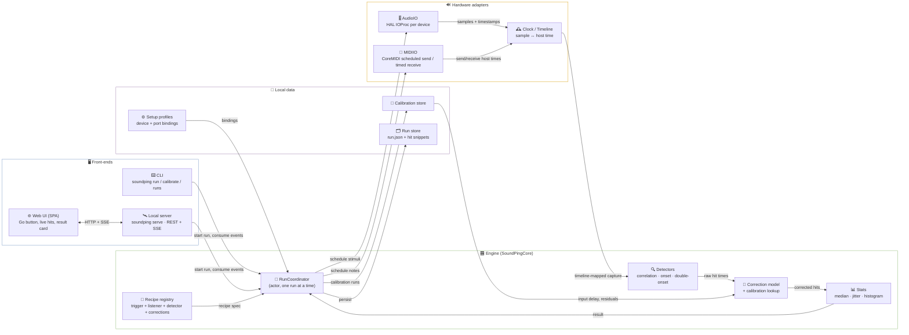
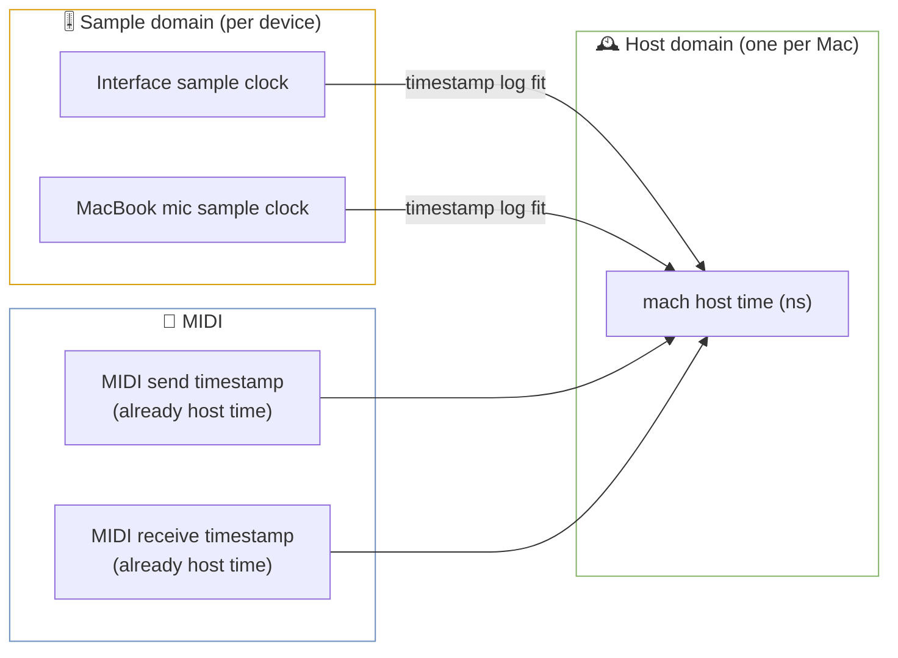
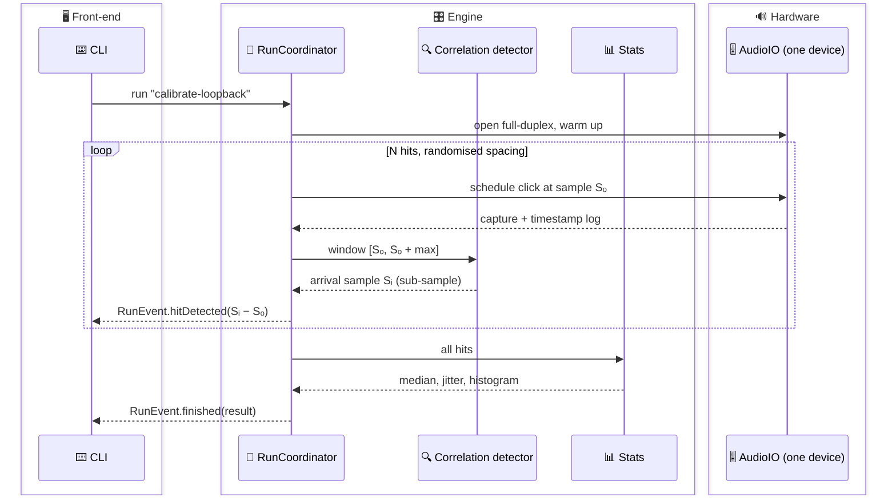
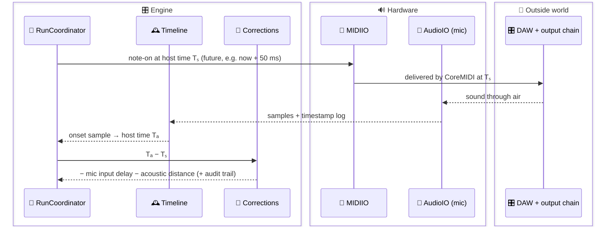
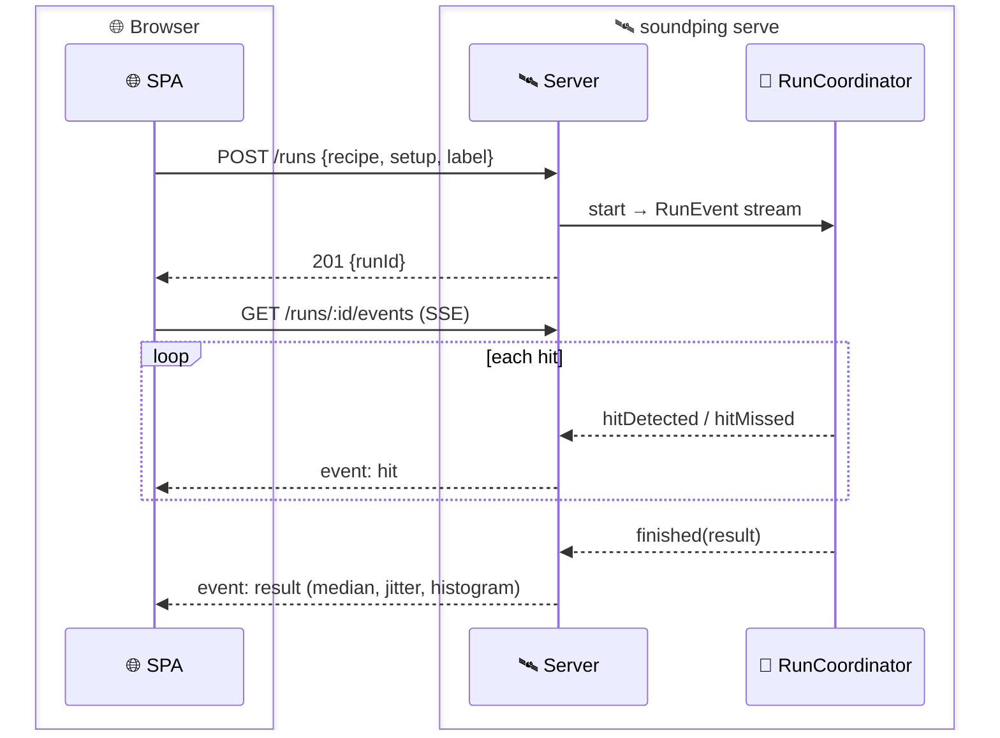
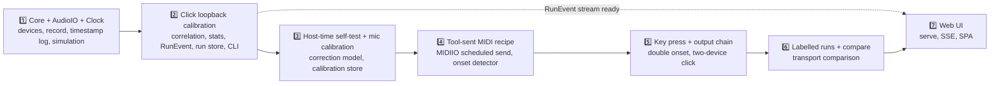

# 🏗️ Architecture Research

**Domain:** Local macOS audio/MIDI latency measurement tool (engine + recipes + CLI + local web UI)
**Researched:** 2026-11-11
**Confidence:** MEDIUM overall
- HIGH-ish on structure (standard measurement pattern + clean layering)
- MEDIUM on CoreAudio/CoreMIDI timestamp semantics (Apple docs + Apple mailing-list consensus, needs on-hardware proof in Phase 1)
- LOW on exact HAL latency-property arithmetic (community disagreement on safety offset)

---

## 🎯 Decisions First

- 🕰️ **One timeline: mach host time.** Every event (MIDI send, click out, onset in) is converted to host-time nanoseconds before comparing. Each audio device keeps its own sample clock; host time is the bridge.
- 🧱 **Two measurement domains, kept explicit.**
  - **Sample domain** (same device, same recording): sample-count differences. Sample-accurate, no clock alignment. → click loopback calibration, key-press recipe.
  - **Host domain** (crosses clocks): MIDI send → mic, output device A → input device B. Needs the timestamp mapping + input-delay correction.
- 📅 **Schedule, don't observe.** The engine *schedules* every stimulus at a chosen future time (click at sample N, MIDI note at host time T via CoreMIDI's future-timestamp delivery). The send time is then a fact, not a racy `now()` reading.
- 🔌 **Engine is a library; CLI and web are thin consumers** of one `RunEvent` stream. Engine never prints, never serves HTTP.
- 🧪 **Hardware behind protocols.** `AudioIO` / `MIDIIO` have a simulated backend that injects known latency + jitter → full engine tests run without gear, in CI.
- 🧾 **Every number carries its audit trail.** Results list each correction applied (mic input delay, acoustic distance, HAL-reported offsets) and each assumption. No silent offsets.
- 🦅 **Native Swift engine, HAL-level I/O** (AudioDeviceIOProc / AUHAL), not AVAudioEngine taps. Exact stack choice lives in STACK.md; this architecture assumes Swift + SwiftPM.

---

## 🗺️ System Overview



- ➡️ **Dependency direction:** front-ends → engine → hardware adapters. Nothing points back up except the `RunEvent` stream (async, push).
- 🧮 **Detectors, corrections, stats are pure functions**: samples + timeline in, numbers out. They are the bulk of the testable logic.

---

## 🧩 Component Responsibilities

| Component | Owns | Typical implementation |
|---|---|---|
| 🎚️ **AudioIO** | Open a device by UID, full-duplex IOProc, preallocated capture buffer, per-callback timestamp log, play pre-rendered clicks at exact sample positions, read HAL latency props (device latency, stream latency, safety offset, buffer frames) | `AudioDeviceCreateIOProcIDWithBlock` or AUHAL; real-time-safe callback (no alloc, no locks); possibly a tiny C target |
| 🎹 **MIDIIO** | Enumerate destinations/sources by unique ID + name, send note-on/off at a **future host timestamp**, record incoming MIDI with receive timestamps | CoreMIDI `MIDISendEventList` (macOS 11+); timestamps are host time |
| 🕰️ **Clock / Timeline** | Host-tick ↔ ns conversion; per-device `sampleTime → hostTime` mapping from the timestamp log; drift/rate estimate; sanity checks (gaps, overloads) | Linear fit over `(mSampleTime, mHostTime)` pairs, `mRateScalar` aware |
| 🎯 **Triggers** | Produce stimuli: `ClickTrigger`, `MIDINoteTrigger`, `HumanTrigger` (key press). Each declares its time domain and expected fire time (or none) | Protocol `Trigger` |
| 👂 **Listeners** | Bind an input device + channel; tag *what* it hears (mic = acoustic, loopback = electrical) so the right correction applies | Protocol `Listener`; mostly config over AudioIO |
| 🔍 **Detectors** | Find the arrival of each hit in its window: cross-correlation with a known template (click), energy onset with adaptive noise floor (unknown DAW sound), double onset (key click → sound) | Pure DSP, Accelerate/vDSP; sub-sample peak interpolation |
| 🧮 **Correction model** | Turn raw arrival − fire into segment latency: subtract mic input delay, acoustic time-of-flight, known output path; attach the audit trail | Pure; reads calibration store |
| 📐 **Calibration store** | Calibrated delays keyed by `(device UID, channel, sample rate, buffer size)`; staleness rules | JSON file |
| 📊 **Stats** | Median, jitter (IQR / MAD), p5/p95, min/max, histogram bins, miss count, outlier policy | Pure |
| 🧪 **RunCoordinator** | Arm listeners, warm up, schedule N hits with randomised spacing, collect detections, emit `RunEvent`s, finalise + persist | Swift `actor`, `AsyncStream<RunEvent>` |
| 📜 **Recipe registry** | Named recipes = trigger kind + listener kind + detector + correction rules + defaults (N, spacing, window) | Code-defined types; parameters from config |
| ⚙️ **Setup profiles** | User's bindings: which output device, input device/channel, MIDI port, mic distance, DAW label | Config file, CLI flags override |
| 🗂️ **Run store** | Labelled runs, schema-versioned, re-analysable | One folder per run: `run.json` + hit snippets (WAV) |
| ⌨️ **CLI** | Parse args, pick recipe + setup + label, render progress + result | `swift-argument-parser` |
| 🛰️ **Local server + 🌐 SPA** | `POST /runs`, `GET /runs`, SSE `GET /runs/:id/events`; serve static UI; bind 127.0.0.1 only | Hummingbird 2 (SSE via streamed body, or `hummingbird-websocket`) |

---

## 🕰️ The Clock Model (core of the design)



- 📏 **Sample → host mapping** for a device, from the IOProc's `AudioTimeStamp` of callback *k*:
  - `host(s) = host_k + (s − sample_k) × nominalTicksPerFrame × rateScalar_k`
  - Fit over many callbacks instead of trusting one: timestamps jitter per callback.
- 🎤 **What the input timestamp means** (Apple coreaudio-api consensus, MEDIUM):
  - IOProc input time ≈ when the buffer was taken at the HAL.
  - Real ADC time ≈ input time − buffer frames − input safety offset − device latency − stream latency (query on the **input** scope).
  - Whether safety offset belongs in the sum is disputed, and drivers often misreport latency. → treat HAL figures as a *prior*; calibration measures the residual.
- 🔁 **Round trip can't be split by measurement alone.** Loopback gives out + in. Attribution needs HAL-reported split + residual, or a differential setup (below). The correction model must record which assumption it used.
- 🧱 **No aggregate devices for measurement.** Separate devices drift; aggregate drift correction resamples and adds unaccounted delay. Open one IOProc per device; reconcile in host time.
- 🧪 **Self-test before trusting host domain:** on one full-duplex device, compute the loopback round trip twice: by sample count, and via the host-time path. They must agree within a sample or two. This is the gate before the MIDI recipe.

---

## 🔄 Data Flow

### 🔁 Click calibration (sample domain, Phase 1 foundation)



- ✅ Pure sample arithmetic. Also produces the device's measured round trip vs HAL-reported round trip → residual saved to calibration store.

### 🎹 Tool-sent MIDI → DAW → mic (host domain)



- ⚠️ The latency is only as good as the mic's input-delay figure. Hence calibration first.
- 🔁 **Differential variant** (recommended option): interleave tool clicks on the *same output device the DAW uses*. Both arrive in one mic recording → mic delay and speaker path cancel. Result = what MIDI transport + DAW add over a direct click.

### 🎹👆 Real key press (sample domain, relative)

- 🎤 Mic hears key's mechanical click (t₀) then the sound (t₁), in one recording → `t₁ − t₀` in samples. No clock alignment, no mic correction.
- 🎯 No fire time → detector scans a rolling window for onset pairs; RunCoordinator paces the user ("press now") and counts hits.
- 💡 Optional extra marker: record the controller's MIDI input with receive timestamps (host time). Splits the gap into controller + transport vs Mac + DAW + output. Host-domain, so it needs the same corrections as the MIDI recipe.

### 📡 Live streaming to the web UI



- 🧵 Same `RunEvent` enum the CLI renders. Web UI adds zero engine code.

### 🧵 Threads inside one run

- 🔴 **Real-time thread (IOProc):** copy input into preallocated buffer, write click samples, append `(sampleTime, hostTime, rateScalar)` to a preallocated log, bump an atomic write index. Nothing else.
- 🟡 **Analysis task:** polls the write index, runs the detector on each hit window as soon as it's complete, emits events. Lag of a buffer or two is fine.
- 🟢 **Front-end task:** renders events.
- 📦 Preallocation is cheap: 60 s × 48 kHz mono float ≈ 11.5 MB.

---

## 📁 Recommended Project Structure

```
Package.swift
Sources/
├── SoundPingCore/          # engine library, no UI, no printing
│   ├── Clock/              # host time, device timelines, fits
│   ├── Audio/              # HAL wrapper, IOProc, capture buffer
│   ├── MIDI/               # CoreMIDI client, scheduled send, timed receive
│   ├── Simulation/         # fake AudioIO/MIDIIO with injected latency + jitter
│   ├── Triggers/
│   ├── Listeners/
│   ├── Detection/          # pure DSP
│   ├── Calibration/        # store + staleness rules
│   ├── Corrections/        # correction model + audit trail
│   ├── Stats/
│   ├── Recipes/            # recipe definitions + registry
│   ├── Engine/             # RunCoordinator, RunEvent, RunResult
│   └── Store/              # run folders, schema versions, setup profiles
├── CRealtime/              # optional: IOProc + ring buffer in C, if Swift RT safety bites
└── soundping/              # single executable
    ├── Commands/           # devices, calibrate, run, runs list/show/compare, serve
    └── Server/             # Hummingbird routes, SSE, static files
Web/                        # SPA source → built into the executable's resources
Tests/
├── SoundPingCoreTests/     # detectors, stats, corrections on synthetic WAVs
└── EngineSimulationTests/  # whole runs on the simulated backend
```

- 🧱 **`SoundPingCore` vs `soundping`:** the evolvability constraint lives here. New recipe = new file in `Recipes/`, no front-end change.
- 🧪 **`Simulation/` in the core,** not tests: the CLI can expose `--simulate` for demos and bug reports.
- 📦 **One binary:** `soundping serve` embeds the web UI. No IPC, no daemon, devices opened by exactly one process.

---

## 🧠 Architectural Patterns

### 1. 📜 Recipe = Trigger × Listener × Detector × Corrections

- **What:** a recipe is data plus four pluggable parts; the engine runs any combination.
- **When:** always. Every Active requirement maps to a recipe:

| Recipe | Trigger | Listener | Detector | Domain | Corrections |
|---|---|---|---|---|---|
| 📐 Calibrate loopback | Click | Loopback (same device) | Correlation | Sample | none (produces residual) |
| 📐 Calibrate mic | Click | Mic | Correlation | Host | produces mic input delay |
| 🎹 MIDI → DAW → mic | MIDI note | Mic | Onset | Host | mic delay, distance |
| 🎹 MIDI → DAW → loopback | MIDI note | Loopback | Onset | Host | loopback input delay |
| 👆 Real key press | Human | Mic | Double onset | Sample | none |
| 🎧 Output chain | Click via processed output | Loopback | Correlation | Host (2 devices) | known direct path |
| 🔀 Transport compare | MIDI note | any | Onset | Host | same recipe, N setups, side by side |

- **Trade-off:** combinations that make no sense (Human + Loopback) must be rejected at recipe-definition time.

```swift
protocol Trigger {
    var domain: TimeDomain { get }                 // .sample(deviceUID) | .host | .none
    func schedule(hit: Int, at: HostTime) throws -> Stimulus
}
protocol Detector {
    func detect(in window: CaptureWindow, expected: Stimulus) -> Detection?   // pure
}
struct Recipe {
    let id: String
    let trigger: TriggerKind, listener: ListenerKind
    let detector: DetectorKind, corrections: [CorrectionRule]
    let defaults: RunParameters                    // N, spacing range, window, warm-up
}
```

### 2. 📅 Scheduled stimuli, windowed detection

- **What:** each hit is scheduled ahead (~50–100 ms) at a known time; detection only searches `[fire, fire + maxLatency]`.
- **Why:** no racy timestamps; echoes and decay of the previous hit can't be mistaken for the next arrival; misses become explicit (`hitMissed`) instead of wrong numbers.
- **Plus:** randomise spacing (e.g. 400–700 ms). A fixed period phase-locks to the buffer cycle and hides jitter.

### 3. 🔁 Differential measurement (reference in the same recording)

- **What:** put a known reference and the unknown stimulus into one recording; subtract onsets in samples.
- **Why:** cancels mic input delay, speaker path and acoustic distance exactly, without cross-clock math.
- **When:** key press (built in), MIDI vs reference click (option), output chain A/B.
- **Trade-off:** measures a *difference* between paths, not an absolute; needs the reference to share the path.

### 4. 🧾 Corrections as an audit trail

- **What:** results store raw arrival − fire, then an ordered list of corrections `{name, value, source: measured|halReported|userEntered, calibrationId}`.
- **Why:** the Accuracy constraint ("a number that hides an uncorrected offset is worse than no number"); also lets old runs be recomputed when a calibration improves.
- **Rule:** missing or stale calibration → the run either refuses or labels the number "uncorrected", never silently uses defaults.

### 5. 🧪 Simulation backend

- **What:** `AudioIO`/`MIDIIO` protocols with a fake that renders captures from a scenario (latency distribution, noise, missed hits, drift).
- **Why:** the engine, detectors, stats, store and both front-ends become testable without gear; reproducible bug reports for strangers' setups.

---

## 💾 Stored Data Shape

- 🗂️ `runs/<timestamp>-<slug>/run.json`
  - `schemaVersion`, `id`, `label`, `createdAt`, `recipeId`, `parameters`
  - `setup` snapshot: device UIDs + names, sample rate, buffer size, MIDI endpoint, mic distance, free-text tags (DAW, transport)
  - `halLatency` report per device
  - `calibrationsUsed[]`
  - `hits[]`: `{index, fireTime, arrival, raw, corrected, corrections[], confidence | missed}`
  - `stats`: median, jitter (IQR + MAD), p5/p95, min/max, histogram, misses
- 🎧 `hits/*.wav` per-hit windows (small) → re-analysable; full capture opt-in (`--keep-audio`).
- 📐 `calibrations.json` keyed by `(deviceUID, channel, sampleRate, bufferFrames)`.
- 📍 Location: `~/Library/Application Support/SoundPing/` default, overridable. Export = copy the folder or a CSV/JSON dump.

---

## 📈 Scaling Considerations

Scale here = run length and history size, not users.

| Scale | Approach |
|---|---|
| 1–100 runs | Folder per run, list by scanning. Fine. |
| 100–5k runs | Add an `index.json` rebuilt on write, for fast list/compare. |
| 5k+ runs or rich queries | SQLite index next to the folders. Unlikely in milestone 1. |
| Long runs (500+ hits) | Preallocate by `N × spacing`; stream per-hit snippets to disk; never hold full capture in JSON. |

- 🥇 **First bottleneck:** web UI loading many histograms → serve stats from the index, raw hits on demand.
- 🥈 **Second:** capture memory on very long runs → ring buffer + per-hit snippet extraction instead of one big buffer.

---

## 🚫 Anti-Patterns

### Timestamping with `Date()` or in the analysis thread
- **Why wrong:** wall clock jumps (NTP); analysis-thread reads are late by a variable amount.
- **Instead:** HAL `AudioTimeStamp` for audio, CoreMIDI timestamps for MIDI, both host time.

### Capturing through AVAudioEngine taps
- **Why wrong:** tap timestamp semantics (buffer start? latency included?) are undocumented (LOW confidence sources), tap buffer sizes are large, and macOS has no `AVAudioSession` latency props.
- **Instead:** HAL IOProc / AUHAL with the raw `AudioTimeStamp`.

### Aggregate devices to "solve" two clocks
- **Why wrong:** drift-correction resampling adds unknown delay to the very thing being measured.
- **Instead:** separate IOProcs, host-time reconciliation, sample domain where possible.

### Fixed-interval hits, whole-recording onset search
- **Why wrong:** phase-locks to buffers (hides jitter); echoes become false hits.
- **Instead:** randomised spacing + windowed detection + explicit misses.

### Engine that prints or knows HTTP
- **Why wrong:** web UI later means a rewrite.
- **Instead:** `AsyncStream<RunEvent>` from day one; CLI is its first consumer.

### Hard-coded devices, ports, Ableton set
- **Why wrong:** breaks the open-source goal; device names also aren't unique.
- **Instead:** bind by UID with name as a display hint; setup profiles; `soundping devices` lists both.

### Mean + dropped misses
- **Why wrong:** one outlier drags the mean; dropping misses hides a flaky chain.
- **Instead:** median + IQR/MAD, report miss count and rate.

---

## 🔌 Integration Points

### External

| Integration | Pattern | Gotchas |
|---|---|---|
| 🎚️ CoreAudio HAL | IOProc per device, property listeners | Input-scope latency props; device vanishing or sample-rate change mid-run → abort run; RT-safe callback |
| 🎹 CoreMIDI | Client + output port, `MIDISendEventList` with future host timestamps; input port for receive stamps | Future scheduling applies to `MIDISend*` to a destination, not to virtual-source `MIDIReceived` (old list post, verify); BT/network MIDI drivers may add their own timing |
| 🎛️ DAW (Ableton or any) | Black box: MIDI in → audio out | No API; user must arm a track/instrument with a sharp attack; document a reference setup |
| 🔐 macOS mic permission (TCC) | Check status at `devices` / run start | CLI's permission belongs to the terminal app; prompt guidance in docs |
| 🌐 Browser | `127.0.0.1` only, SSE for events, REST for commands | Never bind 0.0.0.0; one active run → `409` on concurrent start |

### Internal Boundaries

| Boundary | Communication | Notes |
|---|---|---|
| Front-end ↔ Engine | `start(recipe, setup, label) → AsyncStream<RunEvent>`; store queries | Only public API of the core |
| Engine ↔ AudioIO/MIDIIO | Protocols; schedule + capture handles | Simulated backend implements the same |
| RT thread ↔ analysis | Preallocated buffers + atomic indices | No locks, no allocation on RT side |
| Detection/Corrections/Stats | Pure function calls | Unit-tested on synthetic WAVs |
| Engine ↔ Store | Value types → JSON (Codable) | `schemaVersion` from the first run |

---

## 🧭 Suggested Build Order



- 1️⃣ **Core + AudioIO + Clock first.** Everything rests on correct HAL capture and the timestamp log. Ship `devices` + `record` to prove capture; build the simulation backend now so later phases test without gear.
- 2️⃣ **Click loopback next.** Sample domain only → the first trustworthy number. Introduces `Recipe`, `RunCoordinator`, `RunEvent`, stats, run store in their simplest form; everything later reuses them.
- 3️⃣ **Prove the host domain before MIDI.** Same-device round trip via sample count vs via host time must match; then mic calibration fills the calibration store. Debugging clock alignment *inside* the MIDI recipe is the trap PROJECT.md warns about.
- 4️⃣ **MIDI recipe.** Adds MIDIIO + onset detector (unknown sound). Differential-click option fits here.
- 5️⃣ **Key press + output chain.** Mostly new detectors/recipe configs on existing machinery; output chain needs the two-device host path from 3.
- 6️⃣ **Labels + compare.** Store queries + side-by-side rendering; transport comparison is the same MIDI recipe across setups.
- 7️⃣ **Web UI last.** Technically unblocked after 2 (stream exists), but it's a pure consumer; doing it after 6 means it shows every recipe and the compare view.

**Research flags**
- 🔬 Phase 1/3: deeper research + on-hardware spikes on HAL timestamp semantics, safety offset, Swift RT safety.
- 🔬 Phase 4: CoreMIDI scheduling behaviour per transport (BT LE MIDI, network/rtpMIDI, USB), onset detection for arbitrary instrument sounds.
- 🔬 Phase 5: double-onset detection (quiet mechanical click before loud sound).
- ✅ Phases 2, 6, 7: standard patterns.

---

## 📚 Sources

- [Apple: MIDISendEventList](https://developer.apple.com/documentation/coremidi/midisendeventlist(_:_:_:)): future-timestamped events are scheduled for delivery; macOS 11+ (official)
- [Apple: MIDITimeStamp](https://developer.apple.com/documentation/coremidi/miditimestamp): host-clock time
- [coreaudio-api: MIDI data with timestamps in the future](https://lists.apple.com/archives/coreaudio-api/2002/Jul/msg00139.html): past/zero timestamp = immediate; scheduling vs `MIDIReceived` (old, verify)
- [coreaudio-api 2009: HAL buffer timestamps with AUHAL](https://lists.apple.com/archives/coreaudio-api/2009/Jul/msg00146.html): input ADC time formula
- [coreaudio-api 2004: AudioTimeStamps in HAL IOProc & HW latency](https://lists.apple.com/archives/coreaudio-api/2004/Oct/msg00267.html): safety offset semantics, thru-time sum
- [coreaudio-api 2009: input/output coupling](https://lists.apple.com/archives/coreaudio-api/2009/Oct/msg00119.html): USB in/out are separate clocks, drift
- [JUCE forum: CoreAudio latencies & safety offsets](https://forum.juce.com/t/audio-device-latencies-safety-offsets-on-mac/15647): reported-latency inconsistencies
- [Apple forums: AVAudioEngine node tap timestamps](https://developer.apple.com/forums/thread/131057): tap timing ambiguity (LOW)
- [Android: Measure audio latency](https://source.android.com/docs/core/audio/latency/measure): round trip via normalized correlation; round trip can't split in/out
- [jack_iodelay man page](https://manpages.debian.org/jessie/jackd2/jack_iodelay.1.en.html): loopback delay to better than one sample
- [CNMAT 2004: audio and gesture latency on Linux and OS X](https://www.cnmat.berkeley.edu/sites/default/files/attachments/2004_audio-and-gesture-latency-measurements-on-linux-and-osx.pdf): MIDI-to-audio marker approach
- [Gearspace: MIDI loopback test design](https://gearspace.com/threads/design-midi-loopback-test.1397965/): absolute MIDI→audio needs capture of both ends
- Context7 `/hummingbird-project/hummingbird` + `/hummingbird-project/hummingbird-websocket`: local Swift server with WebSocket/streaming

---
*Architecture research for: macOS audio/MIDI latency measurement (SoundPing)*
*Researched: 2026-11-11*
