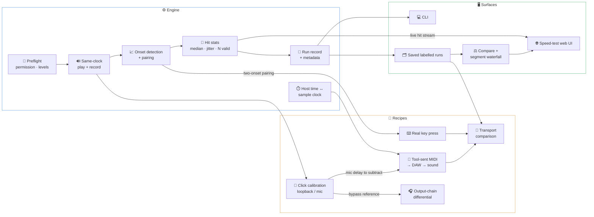

# 🧭 Feature Research

**Domain:** Open-source audio/MIDI latency measurement for musicians (macOS, CoreAudio/CoreMIDI)
**Researched:** 2026-11-11
**Confidence:** MEDIUM
- Competitor features: MEDIUM (several independent reviews and docs per tool)
- "Nothing on macOS does MIDI → DAW → sound": LOW to MEDIUM (based on finding no such tool, plus a KVR thread asking for one)
- Methodology points (randomised spacing, relative loops, two-onset gap): MEDIUM (from published methods and tools)

---

## 🎯 Headline Findings

- 🕳️ **The gap is real.** Existing tools each measure one segment.
  - Audio round trip, by loopback: RTL Utility, MathAudio Latency Meter, CEntrance LTU, jack_delay, Ableton's Driver Error Compensation (DEC) lesson
  - MIDI round trip, by MIDI loopback: alsa-midi-latency-test, jack_midi_latency, Ardour. All Linux.
  - Acoustic round trip (speaker → mic): the Superpowered app (mobile only)
  - None measures **MIDI → DAW → sound** on macOS, compares transports, or splits the chain into segments. People do it by hand in Audacity, measuring the gap between the key click and the sound.

- 📏 **Table stakes are set by RTL Utility**, the tool musicians already know.
  - Pick a device, sample rate and buffer, press one button, get samples + ms back
  - Repeatable within 1–2 samples
  - A SoundPing calibration that wobbles more than that loses trust at once.

- 🎲 **Jitter is what players feel.**
  - Wessel & Wright's guideline: <10 ms latency, <1 ms jitter.
  - Jack et al. 2018: musicians rated a steady 10 ms no worse than zero latency, but rated 10 ms ± 3 ms jitter clearly worse.
  - Median + jitter is the core of the result card, not an extra.

- 🔁 **Relative ("differential") loops are the trusted method for output devices.**
  - RTINGS records two loops, one through the device under test and one bypassing it, and reports the difference.
  - That's exactly SoundPing's output-chain recipe. Make it a first-class pattern, not a one-off.

- 🧮 **Never trust reported latency.**
  - A Pro Tools Duet reported 13 ms; loopback measured 28 ms.
  - Admiral Bumblebee found Live's real MIDI-to-audio latency ~50% higher than Live reported.
  - Showing "macOS/DAW says X, measured Y" is cheap, and nothing else offers it.

---

## 🗺️ Feature Landscape

### ✅ Table Stakes (Users Expect These)

Strangers running this on their own Mac leave if any of these is missing.

| Feature | Why Expected | Complexity | Notes |
|---------|--------------|------------|-------|
| **List and pick devices** (audio in/out device + channel, MIDI port) | Every RTL tool starts with a device dropdown; nothing may be hard-wired to Flo's gear | LOW | `soundping devices` lists everything; selections by name or ID; the same choice is saved per recipe |
| **Loopback round-trip measurement** (click out → cable → in) | The RTL Utility baseline; the first thing anyone runs | MEDIUM | Same audio clock → sample-accurate. Report **samples and ms**. Prefer cross-correlation against the known click over a threshold (MathAudio and jack_delay do this; it's immune to converter ringing) |
| **N hits per run + median + jitter + valid count** | A single sample is not trusted by musicians or the literature | MEDIUM | Show "48/50 hits detected". Define jitter once and print the definition (recommendation: p5–p95 spread as the headline, plus SD and min/max in details) |
| **Randomised hit spacing** | Hits fired at regular intervals can lock to the buffer period and **hide** buffer-quantisation jitter (Pro Tools shows ~1 buffer of jitter) | LOW | Random interval per hit (e.g. 250–600 ms). It lives in the engine, invisible but vital |
| **Distribution graph** (histogram) **+ per-hit timeline** | Speed tests and every MIDI jitter tool (alsa-midi-latency-test, jack2 midi_latency_test) show a histogram; the timeline reveals drift | MEDIUM | CLI: ASCII histogram/sparkline. Web: real chart |
| **Preflight checks** before a run | First-run failures on macOS look like "0 hits" with no clue why | MEDIUM | Mic permission (macOS TCC gives *silent zeros*, not an error), input level too low or clipping, wrong sample rate, nothing heard on the first hit → stop with a plain message |
| **Transparent calibration subtraction** | Core constraint: a number hiding an uncorrected offset is worse than none | MEDIUM | Always show raw → minus calibration → corrected. Flag a calibration that is missing or *stale* (different device, sample rate or buffer) |
| **Automatic run metadata** | Numbers without context can't be compared (forum RTL posts always quote SR + buffer) | LOW | Device names, sample rate, I/O buffer, macOS version, MIDI port/transport, recipe, timestamp, SoundPing version, calibration used |
| **Labelled saved runs + list + compare two** | In PROJECT.md; also the only way to see "did my change help?" | MEDIUM | Free-text label + structured tags (transport, buffer). Local files |
| **Export** (JSON + CSV of per-hit data) | Open-source users want raw data; results stay local | LOW | Per-hit rows plus summary. Same schema the web UI reads |
| **Per-recipe setup guide** | Each recipe needs a different physical setup (cable, mic placement, DAW track) | LOW | `soundping explain <recipe>`: what to connect, where the mic goes, expected range |
| **DAW setup guide for the MIDI recipe** | DAW-agnostic means the user builds the "MIDI note → sound" path themselves | LOW | Steps for Ableton (reference), Logic, GarageBand; **ship a sharp-attack click sample** so onsets are clean |
| **Safe test-signal level** | Clicks at full scale through headphones on a head, or studio monitors, hurt | LOW | Low default level, a warning for headphone recipes, `--level` flag |
| **Stated accuracy per recipe** | Users must know whether 0.3 ms differences are real | LOW | e.g. loopback ±1 sample; mic recipes ~±0.5–1 ms; real key press a few ms. Print it on the result card |
| **Easy install for strangers** | No one will build a Swift/C++ project to measure latency | MEDIUM | Signed + notarised binary or Homebrew tap; mic-permission prompt must work from the CLI (cross-check with the STACK/PITFALLS research) |

### 🚀 Differentiators (Competitive Advantage)

These line up with the Core Value: per-segment numbers that trace a laggy feel to its cause.

| Feature | Value Proposition | Complexity | Notes |
|---------|-------------------|------------|-------|
| **Tool-sent MIDI → any DAW → sound → mic/loopback** | No macOS tool measures this; people do it by hand in Audacity | HIGH | Needs the CoreMIDI send time (host time) mapped onto the audio input sample clock (via CoreAudio timestamps). Loopback listener variant (DAW out → interface in) skips mic uncertainty entirely; offer both |
| **Real key press, two-onset gap** (key clack → sound) | Measures the *felt* chain incl. controller scan + transport; no tool automates it | HIGH | **Self-calibrating:** both onsets travel the same mic path, so mic delay cancels. Remaining errors: different distances (key vs speaker to mic, ~2.9 ms per metre) and pairing clack with sound. Needs pairing logic + rejection of ambiguous pairs |
| **Segment breakdown ("latency waterfall")** | Turns several recipes into "MIDI 4.1 ms · DAW 6.8 ms · output processing 11.2 ms · speaker 2.0 ms" | MEDIUM | Built from saved runs by subtraction; each bar shows its uncertainty and which runs it came from. This is *the* SoundPing view |
| **Transport comparison** (BT / network / cable side by side) | Only anecdotes exist (~+3.5 ms BLE over USB, WIDI 3–10 ms); jitter differences matter more than averages | MEDIUM | Same recipe, three labelled runs, overlaid histograms + a table of median/jitter/max. Mostly UI on top of saved runs |
| **Differential output-chain loops** | The RTINGS method: path through the device minus bypass path = what the device adds | MEDIUM | Generalise: any "A vs B" pair of loopback runs → difference with combined uncertainty. Covers headphone processing, SoundSource-style apps, a wireless speaker module |
| **Speed-test-style local web UI** | Fun, visual, shareable; no latency tool feels like this | HIGH | Big Go, hits land live, result card with median, jitter, graph. Needs a live hit stream from the engine |
| **Reported vs measured** | Exposes drivers and DAWs that misreport (13 vs 28 ms Duet case) | MEDIUM | CoreAudio gives device latency + safety offset + buffer; show it next to the measured loopback |
| **Verdict bands with sources** | "Is 12 ms good?" is the first question; MathAudio labels tiers (Ultra-Low <2 ms … Elevated ≥4 ms) for round trip | LOW | Bands for the whole playing chain (e.g. <10 ms with <1 ms jitter feels instant, per Wessel & Wright / Jack et al.). Label it as guidance, cite the source |
| **Drift / stability view** | BT links and DEC values are reported to drift; a single median hides it | LOW | Per-hit timeline + a "stable / drifting" flag (trend over the run) |
| **Shareable result card** (PNG/Markdown, made locally) | People post latency numbers on Gearspace/KVR; an easy card spreads the tool | LOW | The user posts it themselves; nothing hosted |
| **Ableton DEC hint** | The DEC lesson only tells you it's off; SoundPing can say by how much | LOW | Shows the number; doesn't change Live (fits "SoundPing measures, Flo decides") |

### 🚫 Anti-Features (Commonly Requested, Often Problematic)

| Feature | Why Requested | Why Problematic | Alternative |
|---------|---------------|-----------------|-------------|
| **Online leaderboard / crowd database** | Superpowered has one; feels social | Hosted service, accounts, privacy; out of scope in PROJECT.md | Local export + shareable result card |
| **Auto-tuning the setup** (set buffer, DEC, routing) | "Just fix it for me" | Out of scope; touching DAW/system settings breaks trust and is DAW-specific | Verdict + DEC hint + "what to try next" text |
| **One-number result / mean-only** | Simplicity | Hides jitter, which is what players feel; the mean is pulled by outliers | Median + jitter + distribution, always |
| **Single-shot "measure once"** | Fast | No way to tell noise from signal | Minimum N (e.g. 20) with a quick mode that still reports spread |
| **VST/AU plug-in edition** | MathAudio ships as a plug-in | Ties it to a host, adds plug-in delay compensation as a confound, adds build/notarisation load | DAW-agnostic MIDI recipe + loopback |
| **DAW remote control** (Ableton Remote Script/OSC to set up the track) | Saves setup clicks | Breaks DAW-agnostic; brittle across Live versions | Setup guide + bundled click sample |
| **Injected Mac keypress trigger** | The original README idea | Deferred in PROJECT.md; tool-sent MIDI measures the same segment more cleanly | Tool-sent MIDI |
| **Always-on latency monitor** | "Watch it while I play" | Background mic capture, privacy, CPU, unclear stats | Explicit runs; a quick-rerun shortcut |
| **Full audio analyser** (frequency response, THD, RMAA-style) | "While you're at it" | Scope creep; other tools (REW, RMAA) do it well | Stay latency-only |
| **Custom hardware requirement** (Arduino/Teensy like WALT or Schultz) | Higher precision | Strangers won't build it | Software-only; maybe an optional hardware listener in v2+ |
| **Cross-platform in milestone 1** | Bigger audience | CoreAudio/CoreMIDI timing *is* the point; splits effort | macOS first; keep the engine's platform layer thin |
| **Telemetry / analytics** | "Know how it's used" | Trust killer for a local audio tool that records the mic | GitHub issues + opt-in result export |

---

## 🔗 Feature Dependencies

### 📝 Dependency Notes

- **Every recipe needs** preflight + same-clock I/O + onset detection + stats.
  - Build them once, as the engine; recipes are only trigger + listener config.

- **Tool-sent MIDI needs** calibration + clock alignment.
  - Mic listener: subtract the mic delay measured by calibration.
  - Clock alignment: MIDI send time (host clock) must land on the audio sample timeline. This is the riskiest engineering step; prove it with the loopback listener first.

- **Real key press only needs** onset detection with two-onset pairing.
  - It needs **no** calibration (mic delay cancels), so it can ship in parallel with tool-sent MIDI.

- **Output-chain differential needs** two loopback runs (bypass vs through-device) + saved runs.

- **Transport comparison needs** labels + saved runs + a compare view.
  - It's a UI over the MIDI/key-press recipes, not a new measurement.

- **Segment waterfall needs** saved runs whose metadata match (same device/SR/buffer).
  - So metadata capture is a hard prerequisite, not polish.

- **Web UI needs** the run-record schema + a live per-hit stream.
  - Design the engine to emit hits as events from day one, even though the CLI comes first.
  - Otherwise the web UI forces a rewrite (Evolvability constraint).

- ⚠️ **Conflict: quick mode vs trustworthy stats.**
  - A low-N quick mode must still show spread and the valid count, or it contradicts the "no single number" rule.

---

## 📦 MVP Definition

### 🚢 Launch With (milestone 1)

- [ ] Device listing + selection (audio + MIDI). Nothing works for strangers without it
- [ ] Engine: same-clock play/record, randomised spacing, onset detection, median/jitter/valid-N, histogram + timeline. Everything else stands on it
- [ ] Preflight (permission, levels). Avoids the "0 hits, no clue" first run
- [ ] Click calibration (loopback + mic) with raw → corrected display. The foundation; also the RTL Utility parity test
- [ ] Tool-sent MIDI recipe (loopback and mic listeners). The headline differentiator
- [ ] Real key press recipe. The "what I actually feel" number
- [ ] Output-chain differential recipe. The problem that started SoundPing (SoundSource-style processing)
- [ ] Labelled saved runs + metadata + compare two + JSON/CSV export. Without these, transport comparison and segments can't exist
- [ ] Transport comparison view. Cheap once saved runs exist; high value
- [ ] CLI, then the speed-test web UI. Both are in PROJECT.md for milestone 1
- [ ] Per-recipe setup guides + DAW guide + bundled click sample + stated accuracy. Strangers can't run it otherwise
- [ ] Easy install (signed binary or Homebrew)

### ➕ Add After Validation (v1.x)

- [ ] Segment waterfall: once 2+ recipes produce matching runs reliably
- [ ] Reported vs measured: once loopback is trusted
- [ ] Verdict bands: once there are real-world numbers to sanity-check them
- [ ] Drift/stability flag: when users report "it was fine yesterday"
- [ ] Shareable result card: when strangers start posting results
- [ ] Ableton DEC hint: when Ableton users ask what to do with the number

### 🔭 Future Consideration (v2+)

- [ ] User-written recipe files (trigger + listener as config): once the recipe API has settled
- [ ] Guided buffer sweep (prompt the user to change the buffer, auto-label each run): measures, doesn't tune
- [ ] Other OSes: the platform layer must be proven on macOS first
- [ ] Optional hardware listener (piezo/contact mic on the key): if the precision of the mic-based key press proves too low

---

## 📊 Feature Prioritization Matrix

| Feature | User Value | Implementation Cost | Priority |
|---------|------------|---------------------|----------|
| Engine (I/O, onsets, stats, random spacing) | HIGH | HIGH | P1 |
| Device selection + preflight | HIGH | MEDIUM | P1 |
| Click calibration + transparent subtraction | HIGH | MEDIUM | P1 |
| Tool-sent MIDI recipe | HIGH | HIGH | P1 |
| Real key press recipe | HIGH | HIGH | P1 |
| Output-chain differential | HIGH | MEDIUM | P1 |
| Saved labelled runs + metadata + export | HIGH | MEDIUM | P1 |
| Transport comparison view | HIGH | LOW | P1 |
| CLI | HIGH | LOW | P1 |
| Speed-test web UI | MEDIUM | HIGH | P1 (milestone 1 per PROJECT.md) |
| Setup guides + click sample + accuracy notes | HIGH | LOW | P1 |
| Segment waterfall | HIGH | MEDIUM | P2 |
| Reported vs measured | MEDIUM | MEDIUM | P2 |
| Verdict bands | MEDIUM | LOW | P2 |
| Drift flag | MEDIUM | LOW | P2 |
| Shareable result card | MEDIUM | LOW | P2 |
| DEC hint | LOW | LOW | P3 |
| Recipe files / buffer sweep | MEDIUM | MEDIUM | P3 |

---

## 🥊 Competitor Feature Analysis

| Capability | RTL Utility (Oblique) | MathAudio Latency Meter | Ableton DEC lesson | Superpowered app | Linux MIDI testers | RTINGS method | 🎯 SoundPing |
|---|---|---|---|---|---|---|---|
| Audio loopback RTL | ✅ samples + ms | ✅ correlation, 0.01 ms | ✅ by ear/eye in Live | ❌ | ❌ | ✅ | ✅ (calibration) |
| Acoustic (mic) path | ❌ | ❌ | ❌ | ✅ speaker → mic | ❌ | ❌ | ✅ with mic delay subtracted |
| MIDI → DAW → sound | ❌ | ❌ | ❌ | ❌ | partial (MIDI loop only) | ❌ | ✅ |
| Real key press | ❌ | ❌ | ❌ | ❌ | ❌ | ❌ | ✅ |
| Repeated hits + jitter | ❌ (one result) | ❌ | ❌ | range if spread >2× | ✅ histogram, worst case | averages | ✅ median, jitter, histogram, timeline |
| Differential A/B | ❌ | ❌ | ❌ | ❌ | ❌ | ✅ | ✅ first-class |
| Saved / compared runs | logs | ❌ | ❌ | crowd DB (hosted) | ❌ | internal | ✅ local, labelled |
| Platform | macOS + Win | AU/VST/CLAP plug-in | Live only | iOS/Android | Linux | lab | macOS CLI + local web |

---

## 📚 Sources

- RTL Utility: [Gearnews 1.0 release](https://www.gearnews.com/rtl-utility-for-measuring-audio-latency-gets-an-official-release/), [Sound On Sound RTL article](https://www.soundonsound.com/techniques/round-trip-latency-rtl-j-scope-oscilloscope), [KVR thread](https://www.kvraudio.com/forum/viewtopic.php?p=7514551), [AV Watch review](https://av.watch.impress.co.jp/docs/series/dal/1339983.html)
- MathAudio Latency Meter: [product page](https://mathaudio.com/latency-meter.htm), [Sonic State, Jul 2026](https://sonicstate.com/news/2026/07/21/free-plug-in-measures-your-latency/)
- Ableton DEC: [Ableton FAQ](https://help.ableton.com/hc/en-us/articles/115000234830), [Ableton forum drift report](https://forum.ableton.com/viewtopic.php?p=1539087), [bonedo method](https://www.bonedo.de/artikel/latenz-messen-so-bestimmt-ihr-die-aufnahme-verzoegerung-eurer-daw/), [delamar Duet test (reported vs measured)](https://www.delamar.de/test/avid-pro-tools-duet-testbericht/)
- Superpowered: [latency app](https://superpowered.com/latency), [web latency test](https://superpowered.com/webbrowserlatency)
- MIDI tools: [alsa-midi-latency-test](https://www.github.com/koppi/alsa-midi-latency-test), [jack2 midi_latency_test](https://sources.debian.org/src/jack-example-tools/4-4/example-clients/midi_latency_test.c), [midiclockwork](https://github.com/slmnv5/midiclockwork), [Schultz toolbox](https://cris.maastrichtuniversity.nl/portal/en/publications/the-schultz-midi-benchmarking-toolbox-for-midi-interfaces-percussion-pads-and-sound-cards(6ce4ab0c-cf1b-437f-b9a7-6eded8844929).html), [Latency Analysis Software thread](https://homerecording.com/bbs/threads/free-program-measures-midi-latency-jitter.373592), [jack_delay man page](https://manpages.ubuntu.com/manpages/lunar/man1/jack_delay.1.html)
- DAW MIDI jitter: [Admiral Bumblebee DAW v DAW conclusions](https://www.admiralbumblebee.com/music/2020/11/15/daw-v-daw-72-conclusions), [Live post](https://www.admiralbumblebee.com/music/2020/11/01/daw-v-daw-7-live)
- Transports: [CME on Bluetooth MIDI](https://www.cme-pro.com/the-truth-about-bluetooth-midi/), [Nordic BLE-MIDI timing](https://devzone.nordicsemi.com/nordic/nordic-blog/b/blog/posts/optimizing-ble-midi-with-regards-to-timing-1293631358), [Aodyo latency testing](https://community.aodyo.com/post/3215), [NIME 2019 BLE MIDI](https://nime.org/proc/nime2019_wang/), [Loopy Pro wiki](https://wiki.loopypro.com/Bluetooth_vs._USB_Connections)
- Output devices: [RTINGS latency research](https://rtings.com/headphones/learn/research/latency), [JUCE forum BT drift](https://forum.juce.com/t/determine-bluetooth-device-audio-latency/57274)
- Key press acoustic method: [Matt Wright, CCRMA](https://ccrma.stanford.edu/~matt/latencytest), [Psychtoolbox KeyboardLatencyTest](https://github-wiki-see.page/m/aleslab/Psychtoolbox-3-aleslab-fork/wiki/KeyboardLatencyTest), [Arduino forum DIY](https://forum.arduino.cc/t/measuring-latency-via-serial-port/1281265)
- Perception: [Jack et al. 2018](https://qmro.qmul.ac.uk/xmlui/bitstream/handle/123456789/44614/Jack%20Action-sound%20Latency%202018%20Accepted.pdf?sequence=1), [JND audio latency 2024](https://epub.uni-regensburg.de/59003/1/JND_Audio_Latency.pdf)
- Hardware rigs: [Google WALT](https://android.googlesource.com/platform/external/walt/+/refs/heads/android14-dev/README.md)

---
*Feature research for: open-source macOS audio/MIDI latency measurement (SoundPing)*
*Researched: 2026-11-11*
