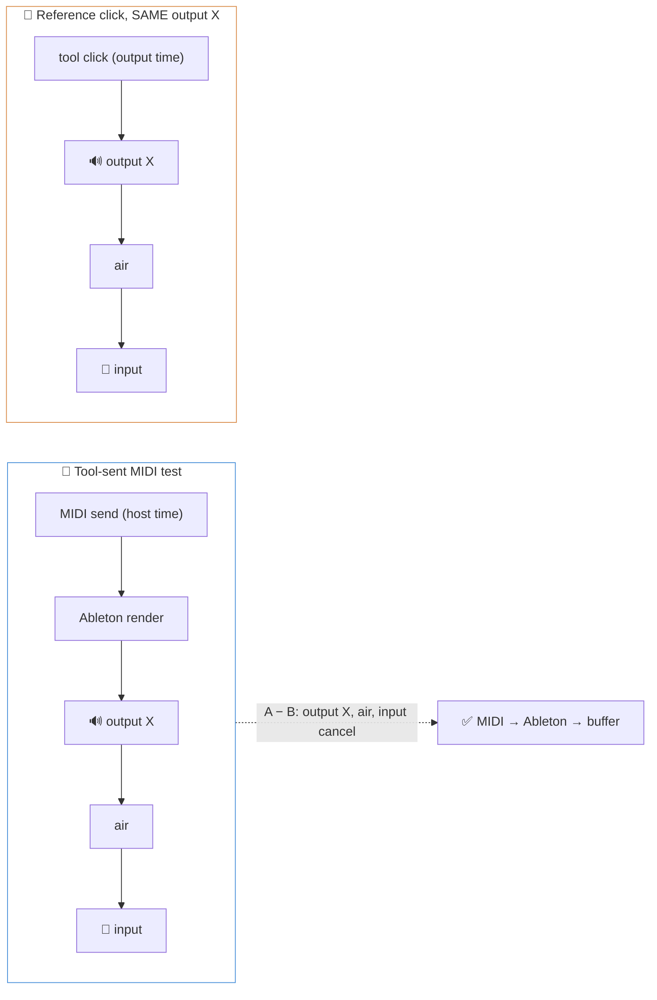

# ⚠️ Pitfalls Research

**Domain:** macOS audio/MIDI latency measurement (CoreAudio + CoreMIDI, acoustic and loopback capture)
**Researched:** 2026-11-11
**Confidence:** MEDIUM overall
- HIGH on clock/timing mechanics and stats (well-established engineering)
- MEDIUM on CoreAudio/Ableton/BLE behaviour (Apple-list archives, Ableton manual, NIME papers)
- LOW on Apple Silicon built-in mic DSP and TCC details (forum reports only; verify on the bench)

---

## 🎯 Top 3 for the roadmap

- 🔴 **A round trip is not the mic delay.** The planned calibration (click out → mic in) measures *output + air + input*, not input alone. Subtracting it from a mic test is wrong unless the recipe is designed so the same terms cancel. → Phase 1 must settle this before anything else builds on it.
- 🔴 **Driver-reported latency lies exactly where SoundPing is most needed.** Built-in mic DSP (~30 ms reported missing on Apple Silicon), routing apps (SoundSource-style), wireless speaker modules: none show up in CoreAudio properties.
- 🔴 **Tool-sent MIDI on the same Mac never crosses Bluetooth/network/cable.** The transport-comparison requirement can't be built on the tool-sent recipe; it needs the key-press recipe or an external echo device.

---

## 🔴 Critical Pitfalls

### 1. 🧮 Treating the click round trip as "mic input delay"

**What goes wrong:**
- Calibration = tool click → output device → (air) → mic → input. Result = `output latency + air time + input latency`.
- Subtracting that from a MIDI→Ableton→speaker→mic test double-subtracts the output path and the air path. The number is wrong, but looks plausible.

**Why it happens:**
- "Same audio clock = sample-accurate" is true for the *sum*. Nothing in a single loopback splits the sum into in vs out.

**How to avoid:**
- Name it honestly: calibration produces **round-trip latency (RTL)**, keyed to `(input device UID, output device UID, sample rate, buffer size)`.
- Design recipes so unknown terms **cancel** instead of being subtracted:

  - Same output device + same speaker position + same mic → difference isolates the MIDI/DAW segment.
  - Key-press recipe: both onsets in one mic recording → input latency cancels for free (keep it that way).
- When an *absolute* one-way number is unavoidable, use the driver-reported value for one direction **only after** the loopback RTL agrees with the reported sum (see pitfall 2). Otherwise flag the result as unsplit.
- Electrical loopback (output → interface input, no air) for calibrating interface paths; the acoustic mic path is a separate calibration.

**Warning signs:**
- Mic-based results that change when you swap speakers but the "calibration" was done on different speakers.
- Calibrated MIDI latency that comes out near zero or negative.

**Phase to address:** Phase 1 (engine + calibration). Re-checked in Phase 2 (tool-sent MIDI) and Phase 5 (output chain).

---

### 2. 📉 Trusting driver-reported latency

**What goes wrong:**
- CoreAudio per-direction latency = `device latency + stream latency + safety offset + buffer frames`. Tools that show only `kAudioDevicePropertyLatency` miss the buffer and stream terms.
- Even the full sum misses what lives outside the driver:
  - Apple Silicon built-in mic: ~30 ms extra input delay attributed to system noise reduction; 40–72 ms built-in mic+speaker round trips reported; internal device latency reported wrong unless inside an aggregate device (LOW, forum reports).
  - Routing/processing apps (SoundSource, surround headphone processing): latency invisible to clients.
  - Wireless speaker modules, Bluetooth outputs: invisible or approximate; BT output latency can change per connection.

**Why it happens:**
- Reported values are what the driver *claims*; Ableton's own Driver Error Compensation exists precisely because interfaces misreport.

**How to avoid:**
- Show **reported vs measured side by side** for every device pair; the gap is a finding, not noise. This is also the feature that would have found the SoundSource problem.
- Read all four terms per direction and log them with each run.
- Never use reported values for built-in mic/speaker without a measured cross-check.

**Warning signs:**
- Measured RTL exceeds reported sum by more than ~1 buffer → something unreported in the path.
- Reported latency identical across buffer sizes → buffer term missing.

**Phase to address:** Phase 1 (log + compare). Phase 5 (output chain) relies on it.

---

### 3. ⏱️ Mixing clock domains

**What goes wrong:**
- Three clocks: audio sample clock (per device), host time (`mach_absolute_time`), CoreMIDI timestamps (host time).
- Common bugs:
  - **mach ticks ≠ nanoseconds on Apple Silicon.** Timebase is 125/3 (24 MHz ticks, ~41.67 ns). Code tested on Intel (1/1) is off by ~42×. Always convert via `mach_timebase_info`.
  - Converting host time → sample index with the *nominal* rate. Audio crystals drift ~10–100 ppm vs host clock; 50 ppm × 60 s = 3 ms error by the end of a minute-long run.
  - Using the wrong edge of the timestamp: HAL input timestamp = when the device captured the buffer (before input latency is accounted); output timestamp = when the buffer leaves (before output latency). Acoustic time = `input time − input latency`, `output time + output latency`.
  - Input and output on **different devices** = different sample clocks; their sample times are not comparable at all.

**How to avoid:**
- Keep the per-buffer `(mSampleTime, mHostTime, mRateScalar)` pairs from every IO callback; map host↔sample by **local interpolation** between neighbouring pairs, never one global linear fit from run start.
- One conversion module, unit-tested on both timebases (fake 1/1 and 125/3).
- Store all event times in one canonical unit (ns host time) plus the original sample index.

**Warning signs:**
- Latency trending up or down across hit index within one run (drift).
- Absurd numbers only on one Mac architecture.

**Phase to address:** Phase 1 (timing core), exercised hard in Phase 2.

---

### 4. 🎛️ The tool's own jitter reported as the system's jitter

**What goes wrong:**
- "Send MIDI now" from a sleeping thread, a GC'd runtime or a Python loop wakes up late by 1–10 ms. If the tool stamps the *intended* time, its own lateness becomes "MIDI jitter".
- Timestamp semantics bite:
  - `MIDISend` with a **future** timestamp → CoreMIDI schedules delivery (good: absorbs dispatch jitter).
  - A **virtual source** (`MIDIReceived`) passes timestamps through unchanged and delivers immediately; the receiver interprets them.
  - Ableton *uses* incoming timestamps and, when monitoring, adds a buffer-based delay to them to remove jitter. A wrong stamp shifts where Ableton renders the note, so the measurement measures your stamp, not reality.

**How to avoid:**
- Stamp with `mach_absolute_time()` read **at the handoff call**, or schedule ahead (now + ~20 ms) via `MIDISend` and treat the scheduled time as truth only after a loopback proves the destination honours it.
- Self-test recipe: tool → MIDI → own MIDI input (IAC or cable loop) to measure the tool's dispatch jitter. Publish it as the floor of every MIDI result.
- Never send MIDI or do analysis on the real-time audio thread; never send MIDI from a GIL-bound callback.

**Warning signs:**
- Jitter that drops when the machine is busier (timer coalescing / CPU idle states) or differs between battery and AC.
- Same jitter across cable, BLE and IAC → it's the tool, not the transport.

**Phase to address:** Phase 2 (tool-sent MIDI).

---

### 5. 🔌 Assuming tool-sent MIDI measures the transport

**What goes wrong:**
- Tool and Ableton run on the same Mac. Tool → virtual port → Ableton never touches Bluetooth, rtpMIDI or a cable. A "BT vs cable" comparison built on it shows identical numbers.

**How to avoid:**
- Transport comparison uses either:
  - the **real key-press recipe** (same controller model on different transports where possible), or
  - an **external echo**: tool → transport → second device (iPhone/second Mac/MIDI thru) → back, measuring round trip and halving only with a stated symmetry assumption.
- Make "which segments does this recipe cover?" a declared field of every recipe, shown with every result.

**Phase to address:** Roadmap design now; Phase 4 (transport comparison).

---

### 6. 🎯 Onset detection that is precise but biased

**What goes wrong:**
- **Threshold crossing** fires later on quiet or slow-attack sounds → latency varies with loudness, not with the system.
- **Slow-attack instrument** in the DAW (pad, sampled piano with soft attack) → several ms of fake latency.
- **Reverb tails / periodic hits** → next hit lands in the previous tail; spurious onsets.
- **Mispairing** in the key-press recipe: release click, key bounce, speaker sound arriving before the next key click → wrong pairs, silently.
- **Clipping** flattens the transient; very quiet key clacks sit at the noise floor.

**How to avoid:**
- Calibration and tool-generated signals: **cross-correlate against the known emitted waveform** (click/chirp) → sub-sample accuracy, level-independent.
- Unknown sounds (synth, key clack): energy-envelope or spectral-flux onset with a fixed rule, plus a documented **reference sound** (zero-attack click/sine instrument) users load in their DAW.
- Pairing with a plausibility window and order rule; **reject and count** ambiguous hits, never guess.
- Pre-flight level check: noise floor, peak headroom, SNR per hit; refuse runs with clipping or SNR under a threshold.
- Keep raw audio per run so detection can be re-run when the algorithm improves.

**Warning signs:**
- Latency correlates with hit loudness or velocity.
- Bimodal histogram (two pairing modes).

**Phase to address:** Phase 1 (correlation detector), Phase 3 (key-press detector + pairing).

---

### 7. 🤐 Plausible garbage from the Mac's own audio stack

**What goes wrong:**
- **TCC denial is silent.** Core Audio returns `noErr` and delivers all-zero buffers. For a CLI, permission belongs to the *responsible process* (Terminal, iTerm, VS Code, Ghostty). Launched from an IDE terminal, launchd or a web-UI backend, the prompt may never appear (LOW, multiple bug reports).
- **Built-in mic processing**: noise reduction may suppress or reshape key clacks and transients; it adds unreported delay (pitfall 2). Mic Modes (Voice Isolation) mainly affect voice-processing apps, but users report music apps hit too (LOW).
- **Voice processing elsewhere**: an app using voice-processing I/O (FaceTime, Zoom) can duck other audio system-wide during a run.
- **Browser capture**: `getUserMedia` defaults to echo cancellation, noise suppression and auto gain on, plus browser buffering.

**How to avoid:**
- Pre-flight: detect digital silence (exact zeros) → "Mic permission likely denied for <parent app>; run `tccutil reset Microphone <bundle id>`".
- If packaged as an app: `NSMicrophoneUsageDescription` in Info.plist + `com.apple.security.device.audio-input` entitlement under hardened runtime.
- Capture only in the native engine; the web UI displays, never records.
- Recommend interface inputs + external mic for serious runs; label built-in-mic runs as such.

**Warning signs:**
- Noise floor exactly −∞ dBFS; zero hits detected with no error.
- Key clacks visible on an external mic but missing on the built-in mic.

**Phase to address:** Phase 1 (pre-flight checks), Phase 7 (web UI must not capture), release phase (docs + packaging).

---

### 8. 🔁 Hit timing that hides jitter

**What goes wrong:**
- Hits fired at a fixed interval that is a multiple of the audio buffer period land at the **same buffer phase** every time → buffer-quantisation jitter (up to one buffer) disappears from the results.
- **Warm-up hits** differ: BLE peripheral in low-power latency, CPU at low clock, DAW lazy-loading a plugin.

**How to avoid:**
- Randomised inter-hit intervals (e.g. 400–900 ms uniform), long enough to clear reverb tails.
- Discard a declared number of warm-up hits, show them separately, never silently.
- Plot latency vs hit index on every result (catches drift and warm-up).

**Phase to address:** Phase 1 (scheduler), Phase 4 (BLE warm-up).

---

### 9. 📊 Statistics that hide the laggy feel

**What goes wrong:**
- Mean + std dev on non-Gaussian data: BLE latency is roughly uniform over a connection interval; network MIDI is long-tailed.
- Deleting outliers deletes the one-in-twenty 40 ms spike that *is* the laggy feel.
- 10 hits → noisy median, meaningless p95; comparing two runs by medians 0.5 ms apart.

**How to avoid:**
- Report: N, rejected count (with reasons), median, **jitter defined explicitly** (recommend IQR or p95−p5; show std dev only as secondary), p95/p99, max, histogram.
- Minimum N: ~30 for median, 100+ when p95 is shown; default runs of 100.
- Outliers are flagged and shown, never dropped from the stats. Only *detection failures* (mispaired, low SNR) are excluded, and counted.
- Comparisons: bootstrap confidence interval on the median difference; label differences inside the CI "no meaningful difference".

**Phase to address:** Phase 1 (stats module), Phase 6 (comparison of saved runs).

---

## 🟠 Moderate Pitfalls

### 10. 🔊 Air time and key mechanics in acoustic recipes

- **Air:** ~2.9 ms per metre. Mic 0.3 m from the keys but 2 m from the speakers → ~5 ms bias in the key-press gap. Mic ≠ ear position.
  - Record distances per run; offer an optional air-time correction; default to mic close to the sound source or loopback.
- **Key mechanics:** note-on fires at the second sensor contact; the audible thud is keybed impact. Their offset varies with velocity and key action (hammer vs synth vs pads).
  - Document as a known systematic offset per controller; use firm, consistent strikes; pads are the cleanest trigger.
- **Phase:** Phase 3.

### 11. 🧩 Shared device state with the DAW and the OS

- **Sample rate is device-global.** If the tool sets it, Ableton's setup changes → measuring something you created. Never change device rate or buffer size; read and log them; abort if they change mid-run (property listeners).
- **Default device switches** (plugging headphones, AirPods connecting) → pin device by **UID** (names are localised and duplicated), abort on change.
- **Opening a Bluetooth headset mic** forces the HFP profile → output quality and latency of the device change. Warn when the chosen input is a BT headset.
- **Aggregate devices**: drift correction resamples and can insert corrections (glitches = spurious onsets); mismatched rates trigger silent SRC. Prefer separate devices + host-time mapping; log aggregate membership and drift-correction flags.
- **Phase:** Phase 1 (device layer), Phase 5.

### 12. 📡 BLE and network MIDI specifics

- **BLE:** connection interval 7.5–15 ms; macOS observed choosing 11.25 ms. NIME 2019 measured BLE adding ~12 ms one way, round trip 29.9 ± 15.0 ms vs 4.3 ± 2.2 ms wired.
  - 13-bit ms packet timestamps exist but receivers often ignore them; CoreMIDI's handling is undocumented → measure, don't assume.
  - 2.4 GHz Wi-Fi coexistence and idle power-save change results → log Wi-Fi state; include warm-up.
- **rtpMIDI:** NIME 2019 minimal Wi-Fi setup 8.5 ± 8.0 ms; Ethernet far steadier. Session "latency" settings add deliberate buffering → record them in the run label.
- **Phase:** Phase 4.

### 13. 🎚️ DAW-dependent numbers presented as "the" latency

- Ableton adds buffer-based delay to monitored MIDI; plugin delay compensation and lookahead plugins on the master add more. Same "Ableton" number differs per set.
- DAW-agnostic means each DAW needs: virtual port enabled, track armed/monitoring, reference instrument. Missing setup → silence → timeouts.
- **Prevention:** a setup checklist per DAW, "no sound within N ms" diagnostics, and logging DAW + buffer + set name.
- **Phase:** Phase 2, release phase.

---

## 🟡 Minor Pitfalls

- **Hard-coded 48 kHz.** Use the device's actual rate everywhere. (Phase 1)
- **Xruns during a run.** Dropouts create fake onsets; listen for processor overload and mark the run invalid. (Phase 1)
- **Licence traps.** aubio (onset detection) is GPL-3; pick DSP deps compatible with the chosen licence before the first public release. (Phase 1 stack choice)
- **System output volume at zero / muted** → timeouts that look like failures. Pre-flight check. (Phase 1)

---

## 🧱 Technical Debt Patterns

| Shortcut | Immediate Benefit | Long-term Cost | When Acceptable |
|---|---|---|---|
| Threshold onset for the click calibration | Ships in an hour | Level-dependent bias baked into every subtraction | Never for calibration; OK as a fallback detector |
| One global host↔sample linear fit | Simple math | ms-scale drift on long runs | Runs under ~10 s only |
| Device names instead of UIDs | Readable config | Breaks on other machines, other languages | Never in saved runs |
| Not saving raw audio | Smaller files | Can't re-analyse when detection improves | Never by default; offer opt-out |
| Single "latency" field per result | Simple UI | Can't tell which segment or what was subtracted | Never |
| Python sleep-based MIDI scheduling | Fast prototype | Tool jitter reported as transport jitter | Only with the self-test floor shown |

## 🔗 Integration Gotchas

| Integration | Common Mistake | Correct Approach |
|---|---|---|
| CoreAudio HAL | Using `kAudioDevicePropertyLatency` alone | Sum device + stream + safety offset + buffer, per scope |
| `mach_absolute_time` | Treating ticks as ns | Convert via `mach_timebase_info` (125/3 on Apple Silicon) |
| CoreMIDI virtual source | Future timestamps expecting scheduled delivery | Virtual sources deliver immediately; receiver interprets stamps |
| Ableton Live | Ignoring monitoring delay and set plugins | Log buffer, monitoring mode, set; use a reference instrument |
| TCC microphone | Assuming an error on denial | Detect all-zero buffers; name the responsible app |
| Aggregate devices | Combining mismatched rates | Log rates + drift-correction flags; prefer separate devices |
| Browser (web UI) | Capturing via `getUserMedia` | Native capture only; browser is display |

## 🐢 Performance Traps

| Trap | Symptoms | Prevention | When It Breaks |
|---|---|---|---|
| Analysis or allocation on the IO thread | Xruns, fake onsets | Lock-free ring buffer; analyse off-thread | Small buffers (≤128 frames) |
| MIDI sent from GIL/GC-bound threads | Jitter that tracks CPU load | Native timestamping or schedule-ahead | Any load; worse on battery |
| Live web UI pushing every sample | UI lag, missed callbacks | Push per-hit results, not audio | Long runs, high rates |

## 🔒 Security Mistakes

| Mistake | Risk | Prevention |
|---|---|---|
| Web UI bound to `0.0.0.0` | Anyone on the LAN can switch the mic on | Bind `127.0.0.1` only |
| No Origin/Host check on the local API | Any website can trigger a recording (CSRF / DNS rebinding) | Check `Origin` + `Host`; per-session token |
| Raw room audio in exported runs | Private conversations leak in bug reports | Raw audio export opt-in, clearly labelled |

## 🧑‍🎤 UX Pitfalls

| Pitfall | User Impact | Better Approach |
|---|---|---|
| One big number, no segment label | "Latency of what?" | Show covered segments + what was subtracted |
| No uncertainty shown | Chasing 0.3 ms "improvements" | CI / "no meaningful difference" badge |
| Silent failures (no hits) | Thinks the tool is broken | Pre-flight checks with named causes |
| Setup steps assumed | Strangers can't reproduce | Guided checklist per recipe and DAW |

## ✅ "Looks Done But Isn't" Checklist

- [ ] **Calibration:** verify it's labelled RTL and keyed to device pair + rate + buffer.
- [ ] **Timing core:** verify unit tests on both mach timebases.
- [ ] **Tool-sent MIDI:** verify the self-test jitter floor is shown beside results.
- [ ] **Onset detection:** verify latency doesn't correlate with hit loudness (run at two volumes).
- [ ] **Stats:** verify rejected hits are counted, not hidden; outliers stay in.
- [ ] **Transport comparison:** verify each recipe actually traverses the transport it's labelled with.
- [ ] **Pre-flight:** verify a denied mic produces a clear error, not "0 hits".
- [ ] **Saved runs:** verify device UIDs, rates, buffers, reported latencies, OS, DAW, distances are stored.
- [ ] **Web UI:** verify it binds localhost and never captures audio itself.

## 🛟 Recovery Strategies

| Pitfall | Recovery Cost | Recovery Steps |
|---|---|---|
| Wrong calibration subtraction shipped | MEDIUM | Re-analyse saved raw audio with corrected recipe math; mark old results |
| No raw audio saved | HIGH | Results can't be re-derived; re-run everything |
| Clock-domain bug | LOW–MEDIUM | Fix conversion module; re-analyse if host/sample pairs were stored |
| Device names in saved runs | LOW | Migration mapping names → UIDs on the original machine |

## 🗺️ Pitfall-to-Phase Mapping

| Pitfall | Prevention Phase | Verification |
|---|---|---|
| 1 RTL ≠ input delay | Phase 1 | Swap speakers: cancelling recipe stays stable |
| 2 Reported vs real | Phase 1, 5 | Reported/measured shown side by side |
| 3 Clock domains | Phase 1 | Timebase unit tests; no trend across 5-min run |
| 4 Tool jitter | Phase 2 | Self-test loop jitter < 0.5 ms |
| 5 Transport not traversed | Roadmap + Phase 4 | Recipe segment declaration reviewed |
| 6 Onset bias | Phase 1, 3 | Two-volume test gives same median |
| 7 Silent Mac stack | Phase 1, 7, release | Deny mic → named error |
| 8 Phase-locked hits | Phase 1 | Randomised intervals in scheduler |
| 9 Stats | Phase 1, 6 | Outliers visible; CI on comparisons |
| 10 Air + key mechanics | Phase 3 | Distances logged; pad vs key comparison |
| 11 Shared device state | Phase 1, 5 | Rate change mid-run aborts |
| 12 BLE / rtpMIDI | Phase 4 | Warm-up shown; Wi-Fi state logged |
| 13 DAW dependence | Phase 2, release | Second DAW (e.g. Logic/Reaper) run documented |

*Phase names assume PROJECT.md order: 1 engine + click calibration (CLI), 2 tool-sent MIDI, 3 real key press, 4 transport comparison, 5 output chain, 6 labelled runs, 7 web UI, then open-source release.*

## 📚 Sources

- Wang, Mulder, Wanderley, "Practical Considerations for MIDI over BLE", NIME 2019 — https://www.nime.org/proceedings/2019/nime2019_paper006.pdf (MEDIUM)
- McPherson et al., "Action-Sound Latency: Are Our Tools Fast Enough?", NIME 2016 — https://nime.org/proc/mcpherson2016 (MEDIUM)
- Ableton Live 12 manual, MIDI Fact Sheet — https://www.ableton.com/en/live-manual/12/midi-fact-sheet/ (MEDIUM)
- Ableton Driver Error Compensation FAQ — https://help.ableton.com/hc/en-us/articles/115000234830 (MEDIUM)
- Apple coreaudio-api archives on latency terms and MIDI timestamps — https://lists.apple.com/archives/coreaudio-api/2010/Jan/msg00046.html, https://lists.apple.com/archives/coreaudio-api/2004/May/msg00154.html (MEDIUM)
- JUCE forum: macOS round-trip latency; M1 internal audio latency — https://forum.juce.com/t/macos-round-trip-latency/45278, https://forum.juce.com/t/m1-internal-audio-round-trip-latency-is-off/45357 (LOW–MEDIUM)
- Apple dev forum: built-in mic processing latency — https://developer.apple.com/forums/thread/704661 (LOW)
- Apple Audio MIDI Setup: aggregate devices — https://support.apple.com/guide/audio-midi-setup/ams094c7edb4/mac (HIGH)
- Nordic: Optimizing BLE-MIDI timing — https://devzone.nordicsemi.com/nordic/nordic-blog/b/blog/posts/optimizing-ble-midi-with-regards-to-timing-1293631358 (MEDIUM)
- CME, "The truth about Bluetooth MIDI" — https://www.cme-pro.com/the-truth-about-bluetooth-midi/ (LOW, vendor)
- "2000 buffers of nothing" (silent TCC zeros) — https://dev.to/nickdelv/2000-buffers-of-nothing-3i8 (LOW)
- Engineering knowledge: mach timebase, crystal drift ppm, buffer-phase aliasing, getUserMedia defaults (HIGH, standard)

---
*Pitfalls research for: macOS audio/MIDI latency measurement*
*Researched: 2026-11-11*
