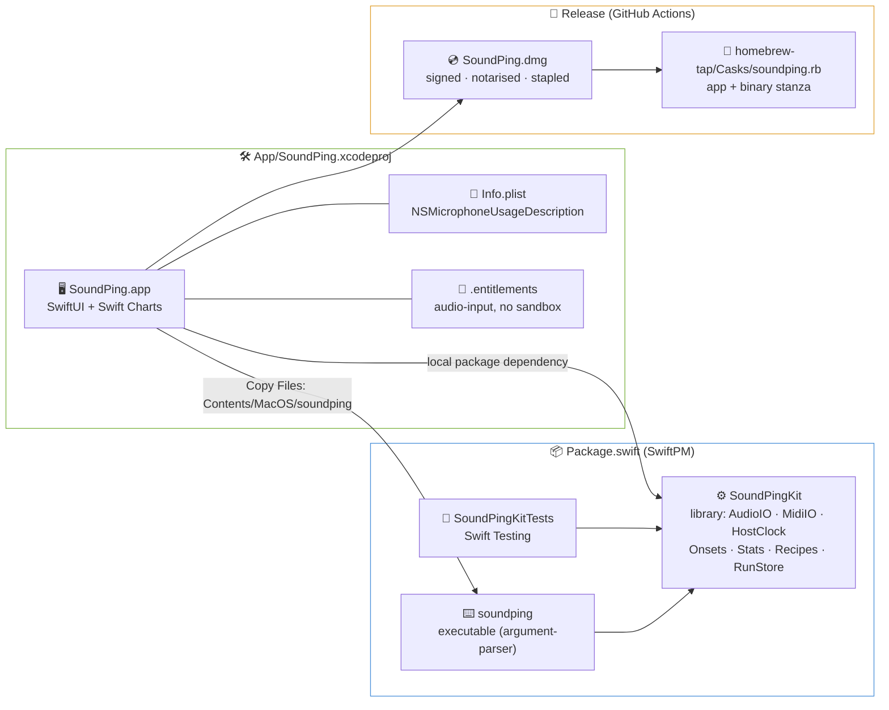
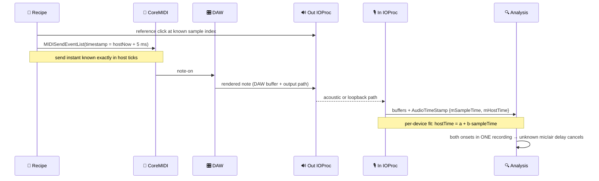
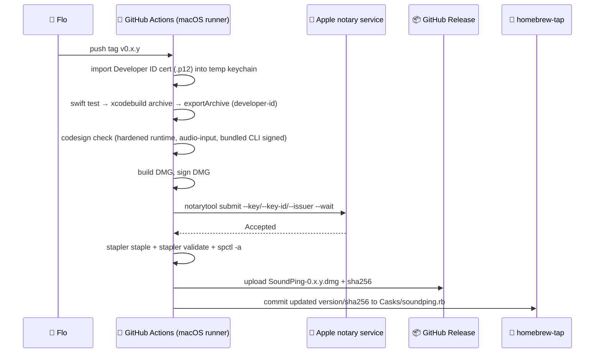

# 🧱 Stack Research

**Domain:** macOS audio/MIDI latency measurement (CLI first, native speed-test app later in milestone 1)
**Researched:** 2026-11-11
**Confidence:** MEDIUM-HIGH overall. Versions and licences were checked on GitHub, xcodereleases.com and the local toolchain. CoreAudio timing semantics and the signing details are MEDIUM, so prove them on the bench.

---

## 🎯 Decisions at a glance

- 🦅 **Language: Swift, one repo.** HIGH
  - A SwiftPM package holds the engine library and the CLI.
  - An Xcode app target consumes that package.

- 🔊 **Audio: raw CoreAudio HAL IOProc, one per device.** HIGH
  - Not AVAudioEngine, not its taps, not aggregate devices.
  - Every buffer comes with `mSampleTime` and `mHostTime`.

- 🎹 **MIDI: raw CoreMIDI** (`MIDISendEventList`, `MIDIInputPortCreateWithProtocol`). HIGH
  - Needed to set and know the exact host-time stamp of each sent note.

- ⏱️ **Common clock = host ticks (`mach_absolute_time`)**, with a fitted sample↔host mapping per device.
  - HIGH that it's the shared base; MEDIUM on the exact stamp semantics.

- 🔍 **Onsets: hand-rolled on Accelerate/vDSP.** HIGH
  - Matched filter for sounds the tool plays.
  - Envelope threshold + backtrack for unknown sounds.

- ⌨️ **CLI: swift-argument-parser 1.8.2.** HIGH

- 🖥️ **App: SwiftUI + Swift Charts + Observation (`@Observable`).** HIGH
  - The engine emits hits as an `AsyncStream`.
  - The app and the CLI both just consume that stream.

- 🔐 **Not sandboxed. Hardened runtime + `com.apple.security.device.audio-input`. Developer ID signed and notarised.** MEDIUM-HIGH

- 📦 **Distribution**: GitHub Actions builds, signs, notarises and staples a DMG for each tag. A Homebrew cask in our own tap installs the app and links the bundled CLI. MEDIUM-HIGH

- 🚫 **Web UI dropped.** Hummingbird, SSE and Svelte appear only under "Not chosen".

---

## 🗺️ Repo and target map



- **Why this split:**
  - `swift build` / `swift test` / `swift run soundping` work with only the Command Line Tools. That's the fast loop for the engine and CLI phases, before any app exists.
  - The app needs what SwiftPM can't express: a real `Info.plist`, entitlements, an asset catalog, signing, archive and export. That's what an Xcode target is for.
    - The Xcode project references the package as a **local package** (drag the folder in, or "Add Local…").
  - Use Xcode 16+ **folder-synchronized groups**, so the `.pbxproj` barely changes as files are added. That makes committing the `.xcodeproj` acceptable.
- **The CLI ships inside the app bundle.**
  - A "Copy Files" phase puts it in `Contents/MacOS/soundping`, so one signed, notarised artifact delivers both.
  - The cask's `binary` stanza symlinks it into `$(brew --prefix)/bin`.
- **Engine → UI contract:** `SoundPingKit` exposes `func run(_ recipe: Recipe) -> AsyncThrowingStream<RunEvent, Error>`, with events like `.armed`, `.hit(Hit)`, `.rejected(reason)`, `.finished(RunResult)`.
  - CLI: `for try await` → print lines.
  - App: an `@MainActor @Observable` model appends hits and drives the charts.
  - Neither front end touches CoreAudio.

---

## ⏱️ Timing model (why Swift + raw HAL)



- **One clock: host ticks.**
  - CoreMIDI `MIDITimeStamp` and CoreAudio `AudioTimeStamp.mHostTime` are both `mach_absolute_time` ticks.
  - Convert with `mach_timebase_info`. On Apple Silicon a tick ≈ 41.67 ns, not 1 ns.
- **Per-device mapping.**
  - Each device has its own crystal.
  - Fit sample↔host over a sliding window of IOProc stamps; never trust a single stamp.
- **Reported latencies are hints.**
  - Device/stream latency, safety offset and buffer size get logged with every run.
  - They're never silently subtracted. Calibration is a round trip, and recipes cancel unknowns within one recording, as PROJECT.md says.
- **Schedule MIDI slightly ahead** (≈2–10 ms) to remove send-thread jitter.
  - Log the immediate-send variant once, to confirm the destination honours timestamps.

---

## 🧰 Recommended Stack

### Core Technologies

| Technology | Version | Purpose | Why Recommended | Conf. |
|---|---|---|---|---|
| Swift | **6.4.2** current (Xcode 27.2, released 2026-10-29); local machine has 6.3.3 / Xcode 26.6 | Engine, CLI, app | Native CoreAudio/CoreMIDI/SwiftUI with no FFI. Strict concurrency polices the real-time-callback boundary | HIGH |
| Xcode | 27.2 (CI + release); 26.6 works for dev | App target, signing, archive | Required for the app bundle, entitlements and export. Pin it in CI | HIGH |
| SwiftPM | `swift-tools-version: 6.2` | Engine + CLI + tests | 6.2 floor builds on both the local 6.3 and the current 6.4 toolchains | HIGH |
| macOS deployment target | **macOS 15+** | Floor | `Synchronization` (`Atomic`) for real-time-safe handoff, `@Observable` (14+), `AVAudioApplication` permission APIs (14+), Swift Charts vectorized plots (15+). Process taps need 14.2+ | MEDIUM |
| CoreAudio HAL (`AudioDeviceCreateIOProcIDWithBlock`, `AudioObjectGetPropertyData`) | system | Sample-accurate play + capture per device | Raw `AudioTimeStamp` per buffer, any input/output pair, no hidden buffering or resampling | HIGH |
| CoreMIDI (`MIDISendEventList`, `MIDIInputPortCreateWithProtocol`) | system, macOS 11+ API | Timed note send; controller note arrival stamps | Only way to choose the send timestamp. BLE and network ports are ordinary endpoints once connected | HIGH |
| Accelerate / vDSP | system | FFT correlation, envelopes, filters, sub-sample peak interpolation | Fast, dependency-free, Apple-maintained | HIGH |
| swift-argument-parser | 1.8.2 (Apache-2.0) | CLI subcommands (`devices`, `calibrate`, `run`, `runs list/show/export`) | Standard. `AsyncParsableCommand` for consuming the event stream | HIGH |
| SwiftUI + Observation | system (macOS 15+) | App shell: recipe picker, Go button, live hit list, result card | Engine types plug in directly. `@Observable` keeps view updates cheap at a few hits per second | HIGH |
| Swift Charts | system (macOS 15+) | Live strip/dot plot, histogram, median/IQR rules, waveform debug view | Native, no dependency. `BarMark` + `RuleMark` cover histogram + median; `PointPlot`/`LinePlot` vectorized for waveforms | MEDIUM-HIGH |

### Supporting Libraries

| Library | Version | Licence | Purpose | When to Use | Conf. |
|---|---|---|---|---|---|
| `Synchronization` (stdlib) | Swift 6 | Apache-2.0 | `Atomic<Int>` write index between IOProc and analysis | Always. The IOProc never locks or allocates | HIGH |
| swift-log | 1.17.0 | Apache-2.0 | Structured logs (device props, per-hit diagnostics) | Always | HIGH |
| AVFoundation (`AVAudioFile`, `AVAudioApplication`) | system | — | WAV save/load of raw captures; mic permission status + request | File I/O and permission only, never the capture graph | HIGH |
| CoreAudioKit (`CABTLEMIDIWindowController`) | system | — | In-app Bluetooth MIDI pairing window | App phase, nice-to-have. The CLI tells users to pair in Audio MIDI Setup | MEDIUM |
| Core Audio process taps (`AudioHardwareCreateProcessTap`) | macOS 14.2+ | — | Capture the DAW's output digitally | Later differentiator. Needs its own consent (`NSAudioCaptureUsageDescription`) and an aggregate wrapper, so keep it out of milestone 1 | MEDIUM |
| Sparkle | 2.10.1 (MIT) | MIT | In-app auto-update for DMG users | Optional, post-first-release. Brew users update through the cask (`auto_updates true` if Sparkle is added) | MEDIUM |
| swift-midi (formerly MIDIKit) | 1.1.0 | MIT | Rich MIDI model, endpoint persistence | **Not in milestone 1.** Its public `send(event:)` stamps "now" internally (checked in the `swift-midi-io` source) | HIGH |

### Development Tools

| Tool | Version | Licence | Purpose | Notes |
|---|---|---|---|---|
| just | 1.59.0 | CC0 | `just test`, `just cli`, `just app`, `just release-local` | Flo's convention. Scripts hold the logic |
| Swift Testing | toolchain | Apache-2.0 | Detector, stats, clock-fit tests on synthetic signals | Click at a known fractional delay + noise, then assert ±0.05 ms |
| swift-format | 604.0.0 (`swift format`, bundled) | Apache-2.0 | Formatting | No extra install |
| XcodeGen | 2.46.0 | MIT | Generates `.xcodeproj` from `project.yml` | **Only if** `.pbxproj` conflicts become real. Synchronized folders make it unnecessary for one app target |
| apple-actions/import-codesign-certs | v7.2.0 | MIT | Import the Developer ID `.p12` into a CI keychain | Release workflow |
| BlackHole (`blackhole-2ch` cask) | 0.7.1 | **GPL-3.0** | Virtual loopback device for hardware-free pipeline tests | Dev/test only. Never bundle or link it; recommending it in docs is fine |
| uv + numpy/scipy/matplotlib | uv 0.13.7 | MIT/BSD | Offline cross-check of saved WAV + JSON runs | Dev-only, never shipped |

---

## 🔐 Microphone permission: app vs CLI

| | 🖥️ SoundPing.app | ⌨️ `soundping` CLI (inside the app or `swift run`) |
|---|---|---|
| Who TCC asks about | The app (its bundle id gets its own Microphone entry) | The **responsible process**, i.e. the terminal app (Terminal, iTerm, Ghostty) |
| Info.plist | `NSMicrophoneUsageDescription` (required, or there's no prompt and silent failure) | Embed one anyway via `-Xlinker -sectcreate -Xlinker __TEXT -Xlinker __info_plist -Xlinker Info.plist`, so the binary has an identity when launched by non-terminal parents |
| Hardened runtime entitlement | `com.apple.security.device.audio-input` (**required** under hardened runtime, which notarisation requires) | Same entitlement when signing the bundled copy |
| App Sandbox | **Off** | Off (a sandboxed app's helper must be sandboxed too, and breaks when run from a terminal) |
| Denied mic looks like | Silence (all-zero buffers), not an error | Same |
| Guard | `AVAudioApplication.shared.recordPermission` before arming; treat an all-zero capture as an error | Same check; print "grant Microphone to <terminal app>" |

- **Why no sandbox:** Developer ID distribution doesn't require it. It would cost:
  - **Bundled CLI:** an embedded helper must be sandboxed with an inherit entitlement, so it fails when launched from a terminal.
  - **Process taps:** the later DAW-tap recipe would get harder.
  - **Run files:** you lose free read/write to user-chosen run/export folders.
  - **Entitlement keys:** you'd have to juggle two easily confused ones. `com.apple.security.device.microphone` is the sandbox key; `…audio-input` is the hardened-runtime key.
- **Stable signing in dev:** ad-hoc or changing signatures make TCC re-prompt or forget grants.
  - Sign Debug with your "Apple Development" identity and a fixed bundle id.
  - Reset with `tccutil reset Microphone <bundle-id>`.

---

## 🚀 Signing, notarisation and release



- **Credentials** (GitHub secrets):
  - Developer ID Application cert as base64 `.p12` + password.
    - Create the cert manually in the developer portal: the App Store Connect API can't create Developer ID certs.
  - App Store Connect API key (`.p8` base64, key id, issuer id) for `notarytool`.
    - No 2FA prompts and no app-specific password.
- **Export:** `xcodebuild -exportArchive` with `method = developer-id` signs nested code (the bundled CLI) correctly.
  - Hand-signing with `codesign --deep` is the anti-pattern.
- **Artifact:** a DMG (stapled). A zip can't be stapled, so prefer the DMG.
- **Homebrew cask in our own tap** (`<owner>/homebrew-tap`):
  - `app "SoundPing.app"` + `binary "#{appdir}/SoundPing.app/Contents/MacOS/soundping"`.
  - Homebrew 5 audits casks for signing and notarisation (unsigned casks were scheduled for disable from 2026-09-01). We comply, so there are no `--no-quarantine` workarounds.
  - Submitting to the official `homebrew/cask` later requires notability; start with our own tap.
- **Local fallback:** a `just release-local` script runs the same steps with a keychain profile (`notarytool store-credentials`), for when CI is down.
- **Contributors without an Apple account:**
  - `swift build`/`swift run soundping` work with no signing.
  - The app runs from Xcode with "Sign to Run Locally".

---

## ⚖️ Alternatives Considered

| Recommended | Alternative | When to Use Alternative |
|---|---|---|
| SwiftPM package + Xcode app target | **Pure SwiftPM + bundling script** (copy binary into `.app/Contents/MacOS`, hand-written Info.plist, `codesign`) | If you refuse an `.xcodeproj` entirely. It works, but you hand-roll asset catalogs, entitlements, nested signing and export, which costs more than a small committed project file |
| Committed `.xcodeproj` (synchronized folders) | **XcodeGen 2.46** / **Tuist** | XcodeGen when multiple app targets or frequent merge conflicts appear. Tuist is heavier and wants its own workflow |
| Swift | **Rust** (cpal 0.18.2 + coremidi 0.9.0) | Only if non-Mac platforms enter scope. You lose SwiftUI/Charts, and TCC/process taps/BLE UI need bridging |
| Swift | **Python** (sounddevice 0.5.6 + python-rtmidi 1.5.8) | Spikes and analysis notebooks only. No timestamped MIDI send, and rtmidi was last released in 2023 |
| Raw HAL IOProc | **AUHAL** | If you want built-in format conversion. Still timestamped, one layer more |
| Swift Charts | **DGCharts** (ChartsOrg) | Never needed here. Swift Charts covers histograms and strip plots natively |
| Hand-rolled HAL property wrapper | **CAAudioHardware** 0.7.1 (MIT) | As a reference implementation. It's active but low adoption (~23 stars) |
| Hand-rolled onset detection | **aubio** (GPL-3) / **Essentia** (AGPL-3) / **librosa** 1.0 (ISC) | Offline cross-checks in notebooks only. Coarse hop sizes (5–11 ms), and the GPL/AGPL licences constrain ours |
| JSON + WAV run files | **SQLite (GRDB 7.12, MIT)** | When trend views across hundreds of runs arrive |
| DMG + cask | **Mac App Store** | Not worth it: it forces the sandbox and review, and removes the bundled CLI |

### 🗃️ Not chosen: local web UI

- **Dropped because the app replaces it** (PROJECT.md, Key Decisions):
  - Hummingbird 2.28.1 + hummingbird-websocket 2.8.1 (SSE/WebSocket).
  - Svelte 5 / Vite 8 / Observable Plot 0.6.19 frontend.
- **Browser timing was never an option:**
  - Safari has no Web MIDI (WebKit bug 107250 open since 2013).
  - Browser mic capture gives no per-sample host timestamp.
  - `performance.now()` is clamped to 100 µs.
- **Revisit only** if "view results from another device" becomes a requirement.
  - Even then: a read-only results page, never browser-side timing.

---

## 🚫 What NOT to Use

| Avoid | Why | Use Instead |
|---|---|---|
| AVAudioEngine / `installTap` for measurement | Effectively one (aggregate) device per engine; opaque buffering; variable tap sizes | HAL IOProc per device |
| Aggregate devices for input+output | Adds drift correction and resampling you can't see | Separate IOProcs + per-device host-time fit |
| `Date()` / `ContinuousClock` for alignment | Not the clock CoreAudio/CoreMIDI stamp with | `mach_absolute_time` ticks + `mach_timebase_info` |
| swift-midi `send(event:)` for timed notes | Stamps internally; you can't schedule or know the exact instant | Raw `MIDISendEventList` with your own timestamp |
| Legacy `MIDISend` / `MIDIPacketList` | Superseded by the `MIDIEventList` API (macOS 11+) | `MIDISendEventList`, MIDI 1.0 protocol |
| Locks, allocation, `print`, `async`/actors inside the IOProc | Priority inversion → dropped buffers → corrupted timing | Preallocated capture buffer + `Atomic` index |
| Pushing every audio buffer to SwiftUI | Main-thread churn, UI stalls, and no value to the user | Emit only `RunEvent`s (hits, status); decimate waveforms before charting |
| App Sandbox | Breaks the bundled CLI from a terminal; complicates process taps; zero benefit for Developer ID | Hardened runtime + `audio-input` entitlement |
| `codesign --deep` | Apple discourages it; it mis-signs nested code with the wrong entitlements | `xcodebuild -exportArchive` (developer-id), or sign the inner CLI first, then the app |
| Apple ID + app-specific password in CI | 2FA friction, tied to a person | App Store Connect API key for `notarytool` |
| Bundling GPL code (BlackHole, aubio, jack tools) | Forces GPL on SoundPing before the licence is even chosen | Apache/MIT deps only; GPL tools stay dev-side |

---

## 🔀 Stack Patterns by Variant

- **Calibration (round trip)**
  - Same-device loopback, one clock, sample-accurate. This is the gold standard for proving the engine.
  - Mic + speakers: two IOProcs; check `kAudioDevicePropertyClockDomain`. Reported as a round trip, never "mic delay".

- **Tool-sent MIDI**
  - CoreMIDI send at a scheduled host time + a reference click in the same recording, so the unknown input/air delay cancels.

- **Real key press / transport comparison** (BLE, network, cable)
  - Pure audio-domain gap: mechanical click → synth onset.
  - Optional CoreMIDI input on the controller stamps note arrival, splitting transport from DAW + output.
  - Bluetooth and rtpMIDI must be connected first (Audio MIDI Setup, or `CABTLEMIDIWindowController` in the app).

- **Output chain**
  - Loopback from the headphone amp / processor output into a spare interface input. Same engine, different device pair.

- **Later: DAW-internal latency**
  - Process tap on the DAW = digital capture of its output.

---

## 🔗 Version Compatibility

| Item | Compatible With | Notes |
|---|---|---|
| `swift-tools-version: 6.2` | Swift 6.3.3 (local), 6.4.2 (current) | Keep the floor at 6.2 so contributors on Xcode 26.x still build |
| swift-argument-parser 1.8.2 | tools 6.0+ | — |
| Swift Charts vectorized `PointPlot`/`LinePlot` | macOS 15+ | ForEach marks are fine for ≤ a few hundred hits; vectorized plots for waveforms |
| `Synchronization` | macOS 15+ runtime | Drop to macOS 14 with swift-atomics 1.3.1 if needed |
| `AVAudioApplication` record permission | macOS 14+ | — |
| Process taps | macOS 14.2+ | Later phase |
| Homebrew 5.x casks | signed + notarised required | Our release pipeline satisfies it |
| GitHub-hosted macOS runner | must provide Xcode 27.x | Pin it with `xcode-select` / `DEVELOPER_DIR`; check the runner image's Xcode list when writing the workflow |

---

## 📜 Licence check (everything recommended)

| Component | Licence | Shipped? | OK for any SoundPing licence? |
|---|---|---|---|
| swift-argument-parser, swift-log, Swift stdlib/`Synchronization` | Apache-2.0 | yes | ✅ |
| Sparkle (optional) | MIT | yes | ✅ |
| Apple frameworks (CoreAudio, CoreMIDI, Accelerate, SwiftUI, Charts, AVFoundation, CoreAudioKit) | system | linked | ✅ |
| XcodeGen, apple-actions/import-codesign-certs, just, uv | MIT / CC0 | no (tooling) | ✅ |
| OboeTester `LatencyAnalyzer` (if ported) | Apache-2.0 | maybe (ported code) | ✅ with NOTICE attribution |
| BlackHole | GPL-3.0 | **no** (dev only) | ✅ as long as it's never bundled |
| aubio / Essentia / jack_delay / jack_iodelay | GPL-3 / AGPL-3 / GPL | **no** | ❌ don't copy code; learn from methods only |

---

## 🔭 Existing tools worth learning from

| Tool | Licence | Take-away | Conf. |
|---|---|---|---|
| OboeTester `LatencyAnalyzer.h` (google/oboe) | Apache-2.0 | Coded-burst + normalized correlation, 0–1 confidence per result. Portable | MEDIUM |
| jack_delay (Fons Adriaensen) | GPL | Multi-sine phase method, ≈1/1000-sample accuracy; reports "excess latency" separately | MEDIUM |
| jack_iodelay | GPL | Minimal loopback UX with continuous readout | MEDIUM |
| RTL Utility (Oblique Audio) | free, closed | Independent round-trip cross-check | MEDIUM |
| Ableton "Driver Error Compensation" | built-in | Reference loopback figure | MEDIUM |
| AudioCap (insidegui) | sample code | Working process-tap setup for the later DAW-tap recipe | MEDIUM |
| jack_midi_latency / alsa-midi-latency-test / WALT | GPL / hardware | Jitter stats, histogram presentation, what ground-truth rigs look like | LOW |

- **Gap:** no maintained open-source macOS tool measures MIDI-to-audio latency per segment. (LOW-MEDIUM: a search can't prove absence.)

---

## 📦 Installation

```bash
# Contributors: engine + CLI (no Apple account needed)
xcode-select --install
brew install just
swift test
swift run soundping devices

# Contributors: app
open App/SoundPing.xcodeproj      # Xcode 26.6+ (27.2 recommended); "Sign to Run Locally" works

# Dev-only helpers
brew install --cask blackhole-2ch
brew install uv
```

```swift
// Package.swift (sketch)
// swift-tools-version: 6.2
platforms: [.macOS(.v15)],
products: [
  .library(name: "SoundPingKit", targets: ["SoundPingKit"]),
  .executable(name: "soundping", targets: ["soundping"]),
],
dependencies: [
  .package(url: "https://github.com/apple/swift-argument-parser", from: "1.8.2"),
  .package(url: "https://github.com/apple/swift-log", from: "1.17.0"),
],
```

```bash
# End users (after first release)
brew install --cask <owner>/tap/soundping   # installs SoundPing.app + links `soundping`
```

---

## 📚 Sources

- Local toolchain: Swift 6.3.3, Xcode 26.6, macOS 27.2.1 (HIGH)
- [xcodereleases.com](https://xcodereleases.com/): Xcode 27.2 (2026-10-29), Swift 6.4.2 (HIGH)
- GitHub releases/licence API (2026-11-11): swift-argument-parser 1.8.2, swift-log 1.17.0, swift-midi 1.1.0, Sparkle 2.10.1, XcodeGen 2.46.0, import-codesign-certs v7.2.0, BlackHole 0.7.1 (GPL-3.0, from its LICENSE file), CAAudioHardware 0.7.1, cpal 0.18.2, coremidi 0.9.0, aubio 0.4.9 (GPL-3), Essentia (AGPL-3), GRDB 7.12.0, swift-format 604.0.0, just 1.59.0, uv 0.13.7 (HIGH)
- `swift-midi-io` source (`MIDIManagedSendsMessages.swift`, `MIDIOutputConnection.swift`, `MIDIEventPacket Utilities.swift`) + Context7 `/websites/orchetect_github_io_midikit` (HIGH)
- [Apple: MIDITimeStamp](https://developer.apple.com/documentation/coremidi/miditimestamp), [coreaudio-api: AudioTimeStamp](https://lists.apple.com/archives/coreaudio-api/2014/Jan/msg00011.html) (MEDIUM)
- [Liscio: "It's over between us, AVAudioEngine"](https://supermegaultragroovy.com/2021/01/26/it-s-over-avaudioengine/), [coreaudio-api: AVAudioEngine devices](https://lists.apple.com/archives/coreaudio-api/2019/Sep/msg00001.html) (MEDIUM)
- [Apple: microphone entitlement](https://developer.apple.com/documentation/bundleresources/entitlements/com.apple.security.device.microphone), [SO: audio-input vs microphone](https://kiwix.lema.org/stackoverflow.com_en_all_2023-11/questions/49595811/macos-entitlements-audio-input-vs-microphone), [Apple forums 850614 (Quinn)](https://developer.apple.com/forums/thread/850614) (MEDIUM)
- [steipete: Info.plist in CLI for TCC](https://steipete.me/posts/2025/applescript-cli-macos-complete-guide), [mjtsai: responsible process](https://mjtsai.com/blog/2025/07/07/the-curious-case-of-the-responsible-process/), [Swift forums: entitlements with SwiftPM](https://forums.swift.org/t/use-macos-entitlements-with-swiftpm-or-swift-command-line/42230) (MEDIUM)
- [Homebrew Cask Cookbook (`binary` stanza)](https://docs.brew.sh/Cask-Cookbook), [Workbrew: Homebrew 5.0.0](https://workbrew.com/blog/homebrew-5-0-0) (MEDIUM)
- [gregoryszorc: signing/notarizing in GitHub Actions](https://gregoryszorc.com/docs/apple-codesign/main/apple_codesign_github_actions.html), [sign-and-notarize-gha](https://github.com/GuillaumeFalourd/sign-and-notarize-gha) (MEDIUM)
- [nilcoalescing: distributions with Swift Charts](https://nilcoalescing.com/blog/PlottingDataDistributionsWithSwiftCharts), [WWDC24 Swift Charts vectorized plots](https://nonstrict.eu/wwdcindex/wwdc2024/10155/) (MEDIUM)
- [OboeTester Usage](https://github.com/google/oboe/blob/master/apps/OboeTester/docs/Usage.md), [jack_delay](https://linuxmanpag.es/man/1/jack_delay/), [AudioCap](https://github.com/insidegui/AudioCap) (MEDIUM)
- [caniuse: Web MIDI](https://caniuse.com/midi), [Chrome timer resolution](https://developer.chrome.com/blog/cross-origin-isolated-hr-timers) (for the "not chosen" note; MEDIUM-HIGH)

---
*Stack research for: macOS audio/MIDI latency measurement (SoundPing)*
*Researched: 2026-11-11*
